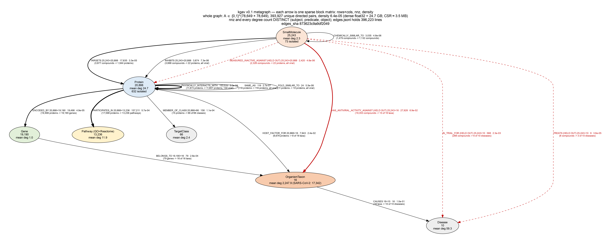

# 06 — Methodology, from first principles

This document assumes you know biology and nothing else. It explains every
idea the measurements in [08-results.md](08-results.md) rest on, in the order
you need them, with a worked example wherever an idea is easier to see than
to define. [07-protocols.md](07-protocols.md) is the specification — exact
flags, exact thresholds, exact file names. This is the reasoning behind it.

Nothing here is a figure of speech. Where a number appears it is read out of
`data/results/` at the moment this page was generated, and where this page
says a thing was measured, `make` will measure it again.

---

## 1. The question, stated so it can be wrong

A virus has no drug. Somewhere in the pharmacopoeia there may be a compound,
already made, already dosed in humans, already known to be safe enough, that
happens to interfere with that virus. Finding it by screening every compound
against every virus is expensive. The hope behind a knowledge graph is that
the literature **already contains the answer in pieces** — this drug binds
that human protein; that protein is required by this virus — and that
assembling the pieces will rank the compounds worth testing first.

That hope is a prediction, and a prediction can be checked. The check is:

> Take compounds whose activity against a virus has actually been measured in
> a laboratory. Hide those measurements from the method. Ask the method to
> rank the compounds. Then look at whether the ones it put at the top are the
> ones that worked.

Everything in this repository is an elaboration of that sentence, and almost
all of the difficulty is in the word **hide**. A measurement is not hidden
just because you did not pass it to the scorer; it is hidden only when
nothing the scorer *can* see is a proxy for it. Sections 9 to 13 are five
different ways that hiding fails, each with the experiment that detects it.

---

## 2. What a knowledge graph is

A **node** is a thing: one compound, one protein, one gene, one pathway, one
virus, one disease. Every node has an identifier from a public vocabulary, so
that two sources talking about the same thing produce one node and not two.
The id prefixes this release uses, per class, are in
[02-graph-model.md](02-graph-model.md); note in particular that a **compound
is keyed on its InChIKey, not on its name or its database accession** —
names are not identifiers, and the same molecule carries different
accessions in different sources.

An **edge** is a stated relationship between two nodes, with a direction and
a type. The type is called a **predicate** and is written in capitals. One
real edge from this release, in full:

    INCHIKEY:ZZBMLKMWCXWXCB-UHFFFAOYSA-N  --[ INHIBITS ]-->  UniProtKB:PRO_0000037312
    (a small molecule, keyed on structure)                   (one mature chain of a viral polyprotein)

    qualifiers: ic50_nm 9900.0 · relation "=" · assay_type "binding"
                source infores:chembl · first asserted 2018

Read it left to right: *subject, predicate, object*. The direction matters
and it is not symmetric: `INHIBITS` running the other way would be a
sentence about a protein inhibiting a drug, which is not a thing.

Two things in that edge are worth pausing on. The object is a **mature
chain** (`PRO_…`), not a polyprotein: flaviviruses and coronaviruses express
one long protein that is cut into pieces, and "the drug inhibits the
polyprotein" would be the wrong claim. And `ic50_nm 9900.0` with
`relation "="` is just under 10 µM — which §4 is about.

An edge also carries **qualifiers** — the fields that make it a measurement
rather than an assertion. A single `HAS_ANTIVIRAL_ACTIVITY_AGAINST` edge
carries the potency, the units, the assay type, the cell line, the
publication, the year, and the source database. Two sources asserting the
same subject–predicate–object produce **one** edge whose qualifiers are
merged under a declared precedence, which is why this release holds
396,223 edges from 30,904 merge events.

This release has 7 kinds of node and
16 kinds of edge. The whole picture is one page:
`figures/kgav_metagraph_a4.pdf`.

**Why a graph rather than a table.** A table answers questions about one kind
of thing. A graph answers questions about *chains* — and the repurposing
hypothesis is a chain, three or four links long, which is the subject of §5.

---

## 3. What the edges actually mean, which is less than they sound like

This is the part that is easiest to get wrong and hardest to recover from.

**`INHIBITS` is an in-vitro biochemical or cell-based result**, usually a
half-maximal inhibitory concentration against a purified viral protein. It
means a number came out of an assay. It does not mean the compound reaches
that protein in a patient.

**`HAS_ANTIVIRAL_ACTIVITY_AGAINST` is a concentration–response measurement on
cells infected with a virus**, thresholded (§4). It is the closest
thing in this graph to the thing we care about, which is why it is **held
out**: no scorer is allowed to read it, because it is the answer sheet.

**`TARGETS` is a drug–protein association from a curated pharmacology
database.** Most of these edges do not say which *direction* the effect runs
— agonist or antagonist. On this release, a majority of `TARGETS` edges carry
no direction at all, so "this drug targets a protein the virus needs" cannot
always be turned into "inhibiting it should block infection".

**`HOST_FACTOR_FOR` is a CRISPR screen result**: knocking this gene out made
infection go down. It is a dependency, measured in one cell line, under one
multiplicity of infection.

**`PHYSICALLY_INTERACTS_WITH` is an interaction dataset row.** Some are
binary pulldowns. Many are **spoke-expanded from a complex** — protein A and
protein B were found in the same complex, and the dataset emits an edge
between them. A count of interaction partners mixes these two and should not
be read as a count of binary interactions.

**`CHEMICALLY_SIMILAR_TO` is computed, not observed** — see §11.

Every edge in this release carries its source and, where the source has one,
its publication and year. That is not bookkeeping: §8 and §10 are
entirely about what the publication and the year let you control for.

---

## 4. What "active" means here, and why a threshold is a decision

A concentration–response curve gives a potency — the concentration at which
half the effect is seen. To turn a potency into a label you need a cut, and
any cut is a convention. This project uses a single cut at 10,000 nM (10 µM): a measured potency at or below it is **active** and anything above it is **measured-inactive**. The two bounds are separate parameters and are equal by default, so there is no band between them on this release.

**A compound can still end up in neither class**, and the reasons are about
the *relation* rather than the value:

- a **censored bound** that does not settle it — `> 1,000 nM` proves nothing
  about 10 µM, so it is dropped rather than read as inactive;
- a potency whose relation **nobody stated**, which the source loader reads
  as `=` and flags; a verdict resting on an imputed relation is withheld;
- an edge whose **own potency fields disagree** across the rows merged into
  it, which is recorded rather than resolved.

[05-labels.md](05-labels.md) counts all three on this release.

Two further things deserve attention from anyone reading a result.

**A measured-inactive is not an unmeasured compound.** This distinction is
the single most important one in the document. A compound that was tested and
did not work is *evidence*. A compound nobody ever tested is *absence of
evidence*, and the two behave completely differently in an evaluation:
§9 shows a model that looks excellent and is only predicting which
compounds somebody bothered to measure. On this release
79.9% of the labelled compound–virus pairs are
measured-inactive, which is why the negatives can be drawn from measurement
rather than from silence.

**Some potencies are extrapolations.** A curator reading a curve that never
reached half-maximal effect within the tested concentration range may still
file a number, flagged as falling outside the dose series. This release
carries that flag as a qualifier on every edge that has it; the default
policy is `include` (the alternatives are
`include`, `exclude`), and the count of flagged edges is in
[05-labels.md](05-labels.md). The reasoning for keeping them is the same as
for everything else here: **deleting weak evidence hides it, recording the
flag makes it legible**, and the exclusion is one argument away for anyone
who wants it.

**And the threshold itself has a measurement behind it.** The obvious
objection to any cut is that it is arbitrary. For this one it is partly not:
a large fraction of source rows record a *censored bound* — "greater than 10
µM", because the compound was tested up to 10 µM and did nothing — and the
bound the literature chose is itself data about where the community puts the
line. [05-labels.md](05-labels.md) carries that census.

---

## 5. What a metapath is

A **metapath** is a shape of chain, written as a sequence of node types and
predicates. It is a template: it says what *kind* of route counts as
evidence, and then the graph is searched for every concrete route of that
shape.

The simplest one in this project, **M1**, is the direct-acting hypothesis:

    SmallMolecule --[INHIBITS]--> Protein --[part of]--> OrganismTaxon
    (a drug)                      (a viral protein)      (the virus)

In words: *this drug inhibits a protein that belongs to this virus.* One
concrete instance:

    nirmatrelvir --INHIBITS--> nsp5 (3CL protease) --belongs to--> SARS-CoV-2

A longer one, **M4**, is a host-directed hypothesis:

    SmallMolecule --[TARGETS]--> Protein --[HOST_FACTOR_FOR]--> OrganismTaxon
    (a drug)                     (a human protein)               (the virus)

In words: *this drug acts on a human protein that a CRISPR screen says the
virus needs.* The chain is one hop longer in its reasoning even though it is
the same length on the page, because it depends on a claim about the virus's
biology rather than about the drug's.

This release declares **8 channels**. They are listed with
their exact predicate sequences in [02-graph-model.md](02-graph-model.md).

| code | what it is | path | constraints | hub exclusion |
|:---|:---|:---|:---|:---|
| **M1** | direct-acting | `SmallMolecule → INHIBITS → Protein → ENCODED_BY → Gene → BELONGS_TO → OrganismTaxon` | `INHIBITS.target_resolution` = `chain_from_assay_description` | no |
| **M2** | host-directed, single hop | `SmallMolecule → TARGETS → Protein → HOST_FACTOR_FOR → OrganismTaxon` | `HOST_FACTOR_FOR.direction` = `dependency` | no |
| **M3** | host-directed via virus-host PPI | `SmallMolecule → TARGETS → Protein → PHYSICALLY_INTERACTS_WITH → Protein → ENCODED_BY → Gene → BELONGS_TO → OrganismTaxon` | — | no |
| **M4** | pathway-mediated | `SmallMolecule → TARGETS → Protein → PARTICIPATES_IN → Pathway → <PARTICIPATES_IN → Protein → HOST_FACTOR_FOR → OrganismTaxon` | `HOST_FACTOR_FOR.direction` = `dependency` | yes |
| **M5** | host PPI-mediated | `SmallMolecule → TARGETS → Protein → PHYSICALLY_INTERACTS_WITH → Protein → HOST_FACTOR_FOR → OrganismTaxon` | `HOST_FACTOR_FOR.direction` = `dependency` | yes |
| **M6** | cold start via chemical similarity, host-directed | `SmallMolecule → CHEMICALLY_SIMILAR_TO → SmallMolecule → TARGETS → Protein → HOST_FACTOR_FOR → OrganismTaxon` | `HOST_FACTOR_FOR.direction` = `dependency` | no |
| **M7** | cold start via chemical similarity, direct-acting | `SmallMolecule → CHEMICALLY_SIMILAR_TO → SmallMolecule → INHIBITS → Protein → ENCODED_BY → Gene → BELONGS_TO → OrganismTaxon` | `INHIBITS.target_resolution` = `chain_from_assay_description` | no |
| **M8** | cross-family direct-acting via conserved fold, catalytic type gated | `SmallMolecule → INHIBITS → Protein → FOLD_SIMILAR_TO → Protein → ENCODED_BY → Gene → BELONGS_TO → OrganismTaxon` | `FOLD_SIMILAR_TO.catalytic_type_match` = `True`; `INHIBITS.target_resolution` = `chain_from_assay_description` | yes |

**A channel can be empty, and that is a result.** If a virus has no
`HOST_FACTOR_FOR` edge at all, then M4 produces nothing for it — not a low
score, *nothing*. On this release 8 of the
16 viruses are in that position
(DENV-1, DENV-3, DENV-4, HCoV-HKU1, JEV, SARS-CoV, TBEV, Yellow fever). An empty ranking and a ranking in which
nothing scored well look identical to a reader and are completely different
facts, so the agent refuses rather than returning an empty list.

---

## 6. Turning a chain into a number, and why it leaks

Counting routes does not work, because the count is dominated by hubs. A
human protein that appears in four hundred interaction datasets will sit on
the end of thousands of chains, and so will every drug that touches it —
which measures how well-studied the protein is, not whether the drug works.

The standard remedy is a **degree-weighted path count**: each route's
contribution is divided by the connectivity of the nodes along it, raised to
a damping power, so that a route through a hub counts for less than a route
through an obscure node. That is what `walk_metapath` computes.

**It does not fully work here, and the repository measures the failure rather
than asserting the fix.** Two specific departures are recorded in
[14-defect-ledger.md](14-defect-ledger.md):

- the **starting compound's own degree is not divided out**, so a compound
  with more edges accumulates more score regardless of what those edges are;
- the damping uses each node's **global** degree rather than its degree
  within the predicate being walked, so adding edges of a type the metapath
  never traverses still moves the score.

The consequence is the thing §9 is about: a channel score is partly a
restatement of how busy a compound is in the graph. Both scorings are
implemented side by side so the difference can be measured, and the
measurement is what is published; neither is tuned until the correlation
disappears, because tuning a scorer until a confound vanishes is fitting the
scorer to the confound.

---

## 7. How a scorer is graded: ROC AUC from scratch

Suppose a scorer gives every compound a number, and suppose you know, for
each compound, whether it was active. Line the compounds up from highest
score to lowest. A good scorer puts actives near the top.

The **ROC AUC** turns that into one number:

> Pick one active and one inactive at random. The AUC is the probability
> that the active has the higher score.

So **0.50 is chance** — a coin flip, which is what you get from a scorer that
knows nothing. 1.00 is perfect. **And below 0.50 is not "bad luck": it is
ordering, backwards.** A scorer at 0.20 contains real information; it is
simply being read with the wrong sign. Two prospective cells in this project
sit there, and they are reported as a finding rather than a failure
([08-results.md](08-results.md)).

A worked example, six compounds, three active (`A`) and three not (`-`),
sorted by score:

    rank:   1    2    3    4    5    6
    truth:  A    A    -    A    -    -

There are 3 × 3 = 9 (active, inactive) pairs. Count the pairs the scorer got
right: the active at rank 1 beats all three inactives (3), rank 2 beats all
three (3), rank 4 beats the two below it (2). That is 8 of 9, so the AUC is
8/9 = 0.89. No threshold was chosen anywhere in that calculation, which is
the property that makes AUC the right statistic here: **it reads the whole
ordering, not a cut**, and so it cannot be moved by where someone decides the
list stops.

**Ties have to be handled explicitly.** If two compounds score identically,
the pair contributes half. This matters enormously in this project: several
channels assign the *same* value to hundreds of compounds, and a metric that
breaks ties by insertion order will report whatever the dictionary happened
to do. An early version of this evaluation had exactly that defect — a hit
count that could legitimately be reported as anything from 0 to 8 depending
on insertion order — which is why the tie-safe AUC replaced it and why hit
counts are now published as a **range** when a tie block straddles the cut.

**An interval, always.** An AUC computed from 30 actives is not the same
evidence as one computed from 3,000, and the point estimate does not say
which you have. Every AUC in this repository is published with a 95%
confidence interval (Hanley–McNeil), and "clears chance" always means *the
interval excludes 0.5*, never *the point estimate is above it*.

---

## 8. Why an AUC above chance can still be nothing: the imputation floor

This is the subtlest idea in the project and it changed what several results
mean.

A metapath channel cannot score a compound it has no route to. There are two
things you could do with those compounds: drop them, or give them a floor
score. **Dropping them is indefensible** — a scorer evaluated only on the
compounds it happens to reach has chosen its own test set, and a channel
reaching 3% of the data can post a near-perfect AUC on a sample it selected.
So every unreached compound is ranked at the bottom.

But that has a consequence. Suppose a channel reaches **40% of the actives**
and only **20% of the inactives** — not because it ranks well, but because
actives are better-studied compounds and better-studied compounds have more
edges. Every reached compound outranks every unreached one by construction.
That asymmetry alone produces an AUC above chance **with no ranking ability
whatsoever**.

The size of that free component is exactly computable:

    floor = 0.5 + (coverage_positive − coverage_negative) / 2

With 40% and 20% that is 0.5 + 0.10 = 0.60. A channel reporting 0.61 has
produced **one hundredth** of its margin by ranking, and the rest by reach.
There is a matching **ceiling** — the best an AUC could be at that coverage —
and the fraction of the gap between floor and ceiling that a scorer actually
used is its **skill**. Those three numbers are what make two AUCs comparable;
the raw numbers are not.

Here is the decomposition on the registered publication-disjoint protocol:

<!-- TABLE: auc_decomposition — generated by scripts/write_doc2.py and
     re-derived independently by tests/test_auc_decomposition.py. Do not hand-edit:
     the marker is how that test finds the table, and the rows are a
     function of data/results/. -->
| scorer | reaches +  | reaches −  | floor | AUC | ceiling | skill |
|:---|---:|---:|---:|---:|---:|---:|
| M1 | 3.4% | 0.8% | 0.5128 | 0.5129 | 0.5130 | 22.0% |
| M2 | 12.4% | 11.5% | 0.5045 | 0.5063 | 0.5116 | 26.0% |
| M3 | 16.9% | 10.3% | 0.5328 | 0.5339 | 0.5414 | 12.9% |
| M4 | 33.7% | 27.9% | 0.5292 | 0.5400 | 0.5762 | 22.9% |
| M5 | 28.1% | 21.1% | 0.5350 | 0.5391 | 0.5646 | 13.6% |
| M6 | 5.6% | 2.5% | 0.5155 | 0.5155 | 0.5162 | 8.0% |
| M7 | 0.0% | 0.3% | 0.4984 | 0.4984 | 0.4984 | n/a |
| M8 | 1.1% | 0.0% | 0.5056 | 0.5056 | 0.5056 | n/a |
| **COMBINED** | 42.7% | 31.1% | **0.5578** | 0.5666 | 0.6243 | **13.3%** |
| **degree** | 100.0% | 100.0% | **0.5000** | 0.5700 | 1.0000 | **14.0%** |

Read the last two rows together. The ensemble of all channels and the degree
baseline — which is just *how many edges does this compound have* — are
within a few thousandths of each other, and that near-tie is an artifact of
two different things.

**Degree's floor is exactly 0.5 and the ensemble's is
0.5578.** Degree reaches every compound in both classes, so it
has no coverage asymmetry at all: its margin splits
0.0000 coverage,
0.0700 ranking — every point of it is ranking. The ensemble's margin above chance splits into
**0.0578 of coverage and
0.0088 of ranking** —
87% of it is reach. The two raw numbers are three
thousandths apart and they are not measuring the same thing.

Normalised for reach, the finding survives and gets a reason: the ensemble
used 13.3% of the span available to it and degree used
14.0%, and the evaluable channels fall in the same band. **Every
scorer on this graph, the null hypothesis included, extracts a similar and
uniformly small fraction of the separation its own coverage allows** — which
is sharper than either "degree wins" or "they tie".

**And the same decomposition applies to the prospective split, where it
leaves nothing behind.** `temporal_split.py` records the coverages, so
nothing new had to be measured.

<!-- TABLE: temporal_auc_decomposition — generated by scripts/write_doc2.py
     and re-derived independently by tests/test_auc_decomposition.py. The
     rows are exactly the (policy, virus, scorer) cells whose interval
     excludes chance; when there are none the generator writes the
     sentence instead, because an absent table and an empty one read the
     same. Do not hand-edit. -->
**No temporal cell has an AUC interval excluding 0.5 on this release**, so this table is empty and the paragraph below is what the decomposition says instead. Five cells were here on 2026-11-08 and all five were the similarity leak.

**That sentence is about this table, whose cells are `temporal_split.py`'s
metapath scorers.** Read as a statement about the project it became false on
2026-11-19: the structure scorer registered in
`registrations/prereg_temporal_structure_scorer.md` finds
6 prospective cells whose corrected intervals exclude
chance and 2 that exclude it below
([08-results.md](08-results.md)). The two studies split the labels by time in
the same way and differ in what they rank, so neither bears on the other.

**Across all 41 temporal AUC cells,
31 equal their own imputation floor to four
decimal places**, and the largest deviation from a floor anywhere is
0.0191. **The temporal AUC is a coverage statistic.** A
scorer on this split reaches a few per cent of the test positives and a
smaller fraction of the test negatives; the gap between those two numbers is
the whole figure. The largest floor-to-ceiling span any scorer had to work in
anywhere is 0.0226 — that is all the room a ranking ever had —
and it demonstrably uses none of it.

That is a stronger negative than "no channel separates": the statistic is
dominated by imputation before any scorer is applied, so a future channel
could rank its reached set perfectly and still read near chance.

### Two things this section got wrong, kept because the shape recurs

**An interval that excluded chance and was its own floor.** Before the
similarity-leak fix, the ensemble read 0.526 [0.503, 0.549] here — clearing
the bar on a figure its own reach produced, equal to its imputation floor to
four decimal places, with a ceiling three ten-thousandths above it. Degree
read 0.555 on the same split, also at its floor, and one cell read 0.834 —
the largest AUC anywhere in this project — on an 88% against 25% coverage
gap. All of them are gone and none was ever a result: the similarity layer
was computing neighbours over the whole release and leaking post-cutoff
compounds into the 2021 training graph.

A correct piece of reasoning about leaked data produced a wrong conclusion.
That is why the figures are derived and the leak has a test, and it is why
none of the three is quoted here to four decimals: they describe a graph
that no longer exists, and a four-decimal figure in this folder has to come
out of an artifact.

**A claim that a measurement was impossible, wrong by one grep.** This
section, a registration and the fix list all stated that `temporal_split.py`
records `auc_n_pos` and `auc_n_neg` "but not the coverages", so a row "cannot
be told apart from its own imputation floor". **The fields were there under a
different prefix** — `auc_coverage_pos` and `auc_coverage_neg` — and the
thing called unmeasurable is the sharpest measurement in this section.

**This is why 10 is a hard gate.** A channel reaching
fewer than that many measured actives is reported as *not evaluable* rather
than with a number, because its AUC is describing its own imputation floor
and the confidence interval — computed from the number of labels, not the
number of labels the channel touched — implies far more evidence than the
channel ever saw.

---

## 9. Confound one: the graph measures attention

A compound's degree — its total number of edges — is a measure of how much
the literature has looked at it. Well-studied compounds are also more likely
to have been found active, because they were studied for a reason. So
**degree alone predicts activity**, with no biology in it at all.

That makes degree the right **null hypothesis** for this project. Not an
alternative method to beat: the thing any claimed reasoning has to beat
before it is reasoning. Every protocol here reports a degree baseline beside
the channel it is testing, and on this release:

- cross-sectionally, degree reads 0.5700 [0.5077, 0.6323] and
  **clears chance**, while 0 of the
  8 metapath channels does;
- on the clinical axis degree reads 0.7751
  [0.7385, 0.8116] — by a distance the strongest signal anywhere in
  this repository, and it is pure study volume.

**The baseline has to be computed carefully or it flatters itself.** A degree
baseline that counts a compound's held-out label edges is reading the answer
sheet: on this graph a labelled compound's own
`HAS_ANTIVIRAL_ACTIVITY_AGAINST` edges are a large share of its degree.
Excluding them moved degree down and left every channel unchanged to three
decimals — because nothing but the baseline was reading those edges. That
correction is the difference between "the ensemble loses to counting edges"
and "the ensemble ties with counting edges", and it was a defect in the
control, not in the method under test.

---

## 10. Confound two: the evidence and the answer come from the same paper

A paper reporting that a compound inhibits a viral protease will, in the same
table, report that the compound inhibits the virus in cells. ChEMBL files
those as two records. The graph turns them into two edges — an `INHIBITS`
edge and a `HAS_ANTIVIRAL_ACTIVITY_AGAINST` edge — and the first is the
evidence a scorer walks while the second is the answer it is graded on.

**They are the same observation.** On this release 943 compounds
carry both; 880 of those cite a publication on each side, and
of *those*, **779 — 88.5%** — cite the same one. The
denominator matters: the share is among compounds where both sides have a
publication at all, not among every labelled compound, and quoting it
without that qualifier is recorded in the measuring script's own comment as
a past mistake.

The control is **publication-disjointness**: when scoring a compound, withhold
any evidence edge that shares a publication with the label being predicted.
It is applied by `Graph.load(drop_pubs_shared_with=...)`.

Two things to understand about what it costs and what it cannot reach.

**The cost is the finding.** Withholding co-reported evidence takes the
direct-acting channel's reach over the evaluated actives from roughly half to
almost none — below the evaluability gate, so the row stops being an AUC at
all. **That collapse, not the AUC, is the result**: nearly all of what
looked like direct-acting evidence was the answer, re-reported.

**58 compounds are outside the control rather than cleared
by it.** The mechanism withholds an edge that *shares* a publication with the
label; an edge carrying no publication at all is never a candidate for
withholding, so it is never withheld and never flagged. A virus can therefore
look clean under this control by having nothing to be disjoint from, and the
count of unwithholdable compounds is published beside the result for exactly
that reason.

---

## 11. Confound three: chemical similarity, and what a Tanimoto is

### The representation

A compound is turned into a **fingerprint**: a fixed-length vector of bits,
where each bit records the presence of some local substructure. This project
uses ECFP4 — circular substructures out to radius 2 bonds from
each atom — folded into 2,048 bits.

The **Tanimoto coefficient** between two fingerprints is

    (bits set in both) / (bits set in either)

so 1.0 means identical bit patterns and 0.0 means no shared substructure.

Three things follow immediately, and all three have bitten this project:

1. **Tanimoto 1.0 is not identity.** Folding to 2,048 bits loses
   information: two different molecules can set the same bits. A pair at 1.0
   against a different skeleton is reported with its heavy-atom difference
   rather than read as the same compound.
2. **Similarity is not a biological statement.** It is an assertion about
   substructures. A diagnostic dye can be highly similar to another
   diagnostic dye, which is true and useless.
3. **The same number means different things in different places** — the
   subject of the next subsection.

### The scorer

The structure-derived scorer ranks a candidate compound by the **maximum**
Tanimoto it reaches against any *known active* for that virus. It is
deliberately the simplest possible chemical baseline, and it exists to answer
a question the metapath channels cannot: *is there any signal here at all, or
is the whole problem too thin?*

### Why a flat threshold is wrong in both directions

"Shortlist anything above 0.55" sounds reasonable and is not. What a given
Tanimoto means depends entirely on the chemistry of the virus's own actives.
For one virus, the compounds that were **screened and found inactive** reach
a median maximum similarity of about 0.2 against its known actives — so 0.55
is extraordinary. For another, the failures themselves reach a median near
0.7 — so 0.55 is below average for a compound that did not work.

So this project uses a **resemblance floor** per virus: the median maximum
Tanimoto that that virus's own **screened-and-inactive** compounds reach
against its own known actives. Every row of the read-out carries where it
sits in that distribution, and the floor is the 50% line of it. The unit is
"how many of this virus's known failures does this candidate out-resemble",
which is a number a reader can act on.

### The near-neighbour control, and the result it destroys

If a candidate's nearest known active is its own close analogue — the next
compound in the same published series — then "resembles a known active"
is a statement about a medicinal chemistry programme, not a prediction.

Three controls are registered against this, and all three are run:

| virus | k_cell |
|:---|---:|
| SARS-CoV-2 | 38 |
| DENV-2 | 27 |
| HCoV-OC43 | 27 |
| DENV-3 | 24 |
| DENV-1 | 14 |
| MERS-CoV | 14 |
| Yellow fever | 13 |
| DENV-4 | 12 |
| JEV | 12 |
| TBEV | 11 |
| HCoV-229E | 11 |
| SARS-CoV | 10 |
| Zika | 7 |
| West Nile | 4 |

The cross-sectional AUC survives all three. **The top of the list does not.**
Measured separately on the one population matched by assay rather than by
source, the head of the ranking holds **no actives at all** once each
candidate's nearest known actives are withheld, while the same cell's AUC
still clears its corrected alpha. A precision that vanishes under the
near-neighbour control was never a hit rate; it was analogue retrieval, and
the AUC cannot see the difference because it averages over a ranking nobody
screens.

This is the single most important qualification in the project and it is the
reason [01-overview.md](01-overview.md) says a shortlist row is a
**resemblance claim with the resembled compound named**, never an expected
hit rate.

---

## 12. Confound four: two populations wearing one label

Pooling label sources restores a confound by a different route. Compounds
curated from the medicinal-chemistry literature are antiviral research
compounds and carry viral-target annotations; compounds from a repurposing
panel are library compounds and carry host-target annotations. Pool them and
the two classes differ **by where they came from** as much as by whether they
worked — and a channel can score above or below chance purely on that.

The remedy is to restrict to one screen, where both classes come off the same
plates under one protocol: matched structurally rather than by a filter. That
is the `infores:ncats-opendata` population, under assay type
`cell_based_antiviral`, which is the one the headline cross-sectional figures
are computed on.

The cost of each control, one row at a time, is the sequence that gives the
hard-negative protocol its shape:

<!-- TABLE: hard_negatives_sequence — generated by scripts/write_doc2.py and
     re-derived independently by tests/test_sequence_table.py. Do not hand-edit:
     the marker is how that test finds the table, and the rows are a
     function of data/results/. -->
| # | protocol | + | − | reaches +  | reaches −  | actives reached | M1 |
|:---|:---|---:|---:|---:|---:|---:|:---|
| 1 | `selective-only`, positives only | 436 | 11,048 | 43.8% | 2.0% | 191 | 0.7090 [0.6812, 0.7367] |
| 2 | `all` — no selectivity filter | 1,768 | 11,048 | 28.8% | 2.0% | 510 | 0.6343 [0.6195, 0.6490] |
| 3 | `verified-only`, **both** sides | 633 | 276 | 34.1% | 11.2% | 216 | 0.6137 [0.5754, 0.6520] |
| 4 | + `--publication-disjoint` | 633 | 276 | 0.8% | 2.2% | 5 | **not evaluable** |
| 5 | + `--label-source` (one screen) | 89 | 7,338 | 3.4% | 0.8% | 3 | **not evaluable** |

Read the column on the right downward. Each row adds exactly one control to
the row above, and the channel falls at every step until it stops being
evaluable. **The sequence is the result** — not any one of its rows.

---

## 13. Confound five: time

Every protocol to this point is **cross-sectional**: it splits labels by
publication or by assay, never by date. A cross-sectional result says the
method can separate actives from inactives in a corpus that already contains
both. It does not say the method would have told you anything in advance,
because the chemistry the scorer learns from may have been published *after*
the compound it is ranking.

The prospective protocol fixes a cutoff of **2021**, builds a
training graph from evidence published at or before it, and scores compounds
whose activity was measured after it. That arrangement answers the question
the cross-sectional one cannot: *would this have worked?*

Three details decide whether such a split is real:

- **The graph must be filtered, not just the labels.** Filtering only labels
  leaves post-cutoff evidence in the training graph and leaks the future
  backwards. A similarity layer computed over the *whole* release did exactly
  this and produced five cells that appeared to clear chance; dating a
  computed edge by when its endpoints first appear removed all five.
- **Undated edges are a declared policy, not a default.** Some sources
  publish no per-row date. The policy here is `include`,
  recorded in the artifact, and the alternatives were run.
- **The comparator has to be usable.** A degree baseline computed on a
  pre-cutoff graph that reaches almost none of the compounds being ranked is
  not a baseline. The requirement is that it reach at least
  20% of them, and on this release
  **0** of 10 cells meet
  it — so the prospective cells that clear are **not shown to beat a
  baseline**, because there is none to beat. That is reported as the outcome
  it is.

---

## 14. Testing a set of proteins rather than a set of compounds

The pathway analysis asks a different question with the same discipline: *do
the host proteins a virus depends on cluster into particular pathways?* If
they did, a pathway would be a repurposing target in its own right.

**The null has to be degree-matched, and that is the whole analysis.** A
protein annotated to many pathways is also a protein in many screens, many
interaction datasets and many papers. Compare an observed overlap against a
*uniform* random draw of proteins and well-studied proteins carry the signal;
every answer is then a restatement of how much attention a protein has
already had. So the null permutes **within connectivity bins**: each protein
is replaced by a protein of comparable degree, 100,000 times, and
the observed overlap is compared against that distribution. The binning basis
is `study` — within the studied set, not the whole graph;
binning against the whole graph includes the proteins under test in their own
background, which is circular and produced a confident-looking artifact.

The gap between the two nulls *is* the finding. Overlaps that are significant
at a few parts in a thousand against a uniform null are nothing against a
degree-matched one.

**What a negative result requires.** "We found no enrichment" is only
informative if the reader knows what would have been detectable. Each cell
therefore publishes its **minimum detectable effect** — the smallest excess
the permutation test had the power to see. Failing to detect a doubling is
not evidence against a doubling when the test needed a sevenfold excess.

---

## 15. Multiple comparisons, and why the family is fixed first

Test twenty independent things at the conventional 5% and one will look
significant by construction. The remedy is to correct the threshold for the
number of tests — here, Bonferroni: divide alpha by the family size.

The thing that makes that honest is **fixing the family before seeing the
p-values**. A family chosen afterwards can be made to contain whatever makes
the interesting cell survive. In this repository every correction family is
declared in a pre-registration and is checked against the running code by a
test, so the code cannot quietly use a smaller family than the document
promises:

| family | tests | corrected alpha | the smallest readable cell, at p=0.000841 | how the size is arrived at | survivors |
|:---|---:|:---|:---|:---|:---|
| readable cells only | 13 | 0.00385 | clears, by a factor of 5 | cells that are both `trustworthy` and `hits_determined` | SARS-CoV-2 M7 |
| every cell computed | 61 | 0.00082 | does not clear | every (virus, channel) the run produced | none |
| every cell planned | 120 | 0.00042 | does not clear | (15 viruses x 8 metapaths) | none |
| planned, plus COMBINED and degree | 150 | 0.00033 | does not clear | (15 viruses x 10 scorers) | none |

> the family is reported, not chosen: this project fixes a correction family in a pre-registration before the p-values are in hand, and these were not

The pathway analysis tests each row in **both** directions — enrichment and
depletion — so its family is twice its row count: 22 rows,
44 tests, and an uncorrected 0.05 becomes a
corrected **0.00114**.

---

## 16. Pre-registration, and what it is for

A **pre-registration** is a document, written and signed before the
measurement is run, that fixes: the hypothesis, the exact statistic, the
exact population, the correction family, the decision rule, and what outcome
would count as a failure. It exists because of one asymmetry: after seeing a
result it is always possible to find a defensible-sounding analysis that
makes it significant, and nobody — including the person who did it — can tell
afterwards whether that happened.

In this repository:

- registrations live in `registrations/` and are **amended by appending,
  never by rewriting**. A registration edited to match the result it
  registered is not a registration;
- a test reads each registration and asserts the running code obeys it —
  the permutation count, the alpha, the family size, the exclusion rule.
  A registration nothing checks is a document, not a control;
- when a protocol **refuses to run**, the refusal is written as an artifact
  and kept. 1 of the 36 artifacts in
  `data/results/` is a recorded refusal;
- where a registration was signed *after* the run it fixes, its header says
  so in full, and it is not treated as prospective.

---

## 17. Provenance: a result that cannot name its graph is not a result

The graph is rebuilt. Sources are re-downloaded, a layer is corrected, counts
move. A number computed from last month's graph, sitting in a document beside
numbers from today's, is indistinguishable from a current number.

So: every release is fingerprinted by content hashes of its nodes and edges
(dc6d76a2b3cfb2a1 / 873623c9a9df2049 for `v0.1`); every artifact in
`data/results/` is stamped with the release it was computed from and the code
commit; and `make check-results` fails when an artifact's release has moved.

That protects the artifacts. It does not protect **prose**, which is why this
folder is generated — see [00-README.md](00-README.md). The failure mode is
real and recurring: thirteen stale figures sat in one hand-drawn figure for
seventeen days, and five AUCs quoted from a docstring in an earlier draft of
*this* document described a graph two rebuilds gone.

---

## 18. How to read any result in this repository

A checklist, in the order these failed historically:

1. **Does the interval exclude chance**, or only the point estimate?
2. **Which side** does it exclude it on? Below chance is a finding.
3. **What is the imputation floor** — how much of the margin is reach rather
   than ranking?
4. **How many actives did the scorer actually touch?** Below
   10 the number describes the floor.
5. **What is the degree baseline** on the same cell, and does it clear too?
6. **Which controls were applied** — publication-disjoint, near-neighbour,
   assay-matched, temporal — and which were not?
7. **Was the correction family fixed in advance**, and how large is it?
8. **Is it an ordering statistic or a hit rate?** They disagree here.
9. **Which release** was it computed from?
10. **If it is a null, what was detectable?**

Every one of those is answerable from the artifact itself. That is the
property the whole apparatus exists to produce.
