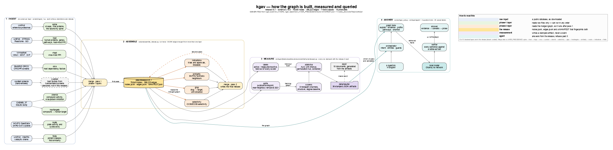
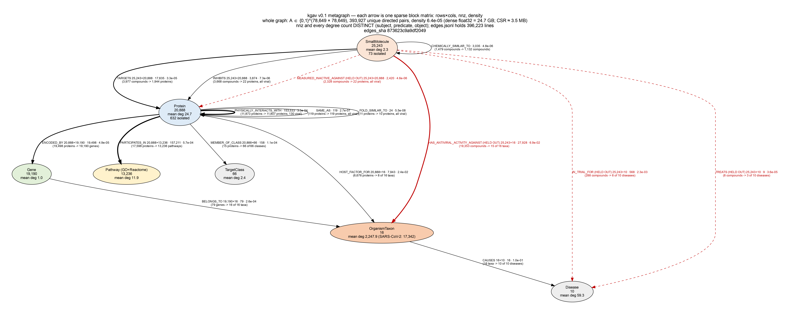

# What a knowledge graph contributes to antiviral drug repurposing: four controlled measurements on 16 viruses

**Release `v0.1`** — 78,649 nodes, 396,223 edges, schema
`0.16.0`, built at commit `e2bc1305fb19`
(nodes `dc6d76a2b3cfb2a1`, edges `873623c9a9df2049`).

*This manuscript is generated. Every figure in it is read out of
`data/results/` at the moment of writing, and `make doc2-check` fails if any
of them has moved. Methods are given in full in
[06-methodology.md](06-methodology.md) and
[07-protocols.md](07-protocols.md); the pre-registrations that fixed each
protocol in advance are in `registrations/`.*

---

## Abstract

Knowledge-graph methods are widely proposed for drug repurposing on the
argument that the literature already contains the evidence in pieces and
that assembling it will rank candidate compounds. That argument is rarely
tested against the controls it requires: the graph's own measure of how
much attention a compound has received, the fact that the evidence and the
answer are frequently the same observation reported twice, and the
difference between separating actives from inactives in a corpus and
predicting them in advance.

We built a knowledge graph of 78,649 nodes and 396,223 edges over
16 coronaviruses and flaviviruses from
12 ingest layers, held out
`HAS_ANTIVIRAL_ACTIVITY_AGAINST`, `IN_TRIAL_FOR`, `MEASURED_INACTIVE_AGAINST`, `TREATS` as the answer, and ran four pre-registered
evaluations.

**First**, of the 8 graph-reasoning channels the schema
declares, **0** has a confidence interval excluding
chance on the one assay-matched population, under a publication-disjoint
control. An ensemble of all channels does clear, at 0.5666
[0.5044, 0.6289], but 87% of its margin above
chance is the asymmetry of what it reaches rather than how it ranks; a
degree baseline — the compound's edge count — reads 0.5700
[0.5077, 0.6323] with no such asymmetry at all.

**Second**, the host proteins each virus depends on show no enrichment in
Reactome pathways against a degree-matched null: 0 of
44 tests survive correction at 100,000
permutations over 22 virus–channel rows, and
2 of the 16 viruses could not be
tested in either channel.

**Third**, a scorer that uses no graph structure — the maximum ECFP4
Tanimoto a candidate reaches against that virus's known actives — clears
its corrected threshold in **8 of 17**
registered cells *above a degree baseline that does not clear*, and the
membership of those cells is identical under both registered
near-neighbour controls. On the one cell matched by assay rather than by
source, the precision of the head of its ranking nevertheless falls to
zero once each candidate's nearest known actives are withheld.

**Fourth**, trained only on activity published at or before
2021 and tested on activity published after it, the same
chemical scorer clears in 6 of
10 cells and clears **below** chance in
2 (West Nile, Zika) — a measured anti-ranking.
**0 of 10** cells have a
usable degree comparator, so none of the prospective results is shown to
beat a baseline.

The contribution of the graph's own reasoning, measured against the
attention baseline on every protocol here, is zero or negative. What
survives is chemistry, it is reported as a resemblance claim rather than an
expected hit rate, and it is licensed for **8 of
16** viruses.

---

## 1. Introduction

A virus with no licensed therapy and a pharmacopoeia of compounds already
dosed in humans is the standing case for repurposing. Screening everything
against everything is expensive, so a ranking is worth a great deal — and a
knowledge graph offers one for free, by assembling published facts into
chains: *this compound inhibits that protein; that protein is required by
this virus.*

The difficulty is not building the graph. It is that almost everything in it
is also a measure of how much attention its subject has already received,
and attention predicts activity without any biology in it. A compound that
has been measured against a virus was measured for a reason; a protein in
many pathways is a protein in many screens. A method that learns attention
will look excellent on retrospective data and will rank nothing useful in
advance.

This paper reports four measurements designed so that failure is visible.
Each has a pre-registration fixing its statistic, population, correction
family and decision rule before the numbers existed; each publishes a
degree baseline beside the thing being tested; each writes a machine-checked
artifact stamped with the graph it was computed from. Two of the four are
negative results and are reported with the effect size they had the power to
detect. Two are positive, and the stronger of the two is positive about
chemistry rather than about the graph.

---

## 2. Methods

### 2.1 The graph

Nodes are drawn from public vocabularies — NCBI Taxonomy, UniProt, ChEMBL,
Reactome, GO, MONDO — so that two sources naming the same entity produce one
node. The release holds:

| node class | nodes | id prefixes |
|:---|---:|:---|
| SmallMolecule | 25,243 | INCHIKEY |
| Protein | 20,888 | UniProtKB |
| Gene | 19,190 | NCBIGene, KGAV |
| Pathway | 13,236 | REACT, GO |
| TargetClass | 66 | SCOP, CATH, PFAM, INTERPRO, SSF, KGAV |
| OrganismTaxon | 16 | NCBITaxon |
| Disease | 10 | MONDO |

Edges are typed, directed and carry qualifiers: potency, units, assay type,
cell line, publication, year, source. Two sources asserting the same
subject–predicate–object produce one edge whose qualifiers merge under a
declared precedence (30,904 such merges in this release,
64,424 of them resolved by an explicit precedence rule).

| predicate | edges | subject → object | flags |
|:---|---:|:---|:---|
| `PARTICIPATES_IN` | 157,211 | Protein → Pathway | — |
| `PHYSICALLY_INTERACTS_WITH` | 153,533 | Protein → Protein | symmetric |
| `HAS_ANTIVIRAL_ACTIVITY_AGAINST` | 29,781 | SmallMolecule → OrganismTaxon | held out, label |
| `ENCODED_BY` | 19,498 | Protein → Gene | — |
| `TARGETS` | 17,635 | SmallMolecule → Protein | — |
| `HOST_FACTOR_FOR` | 8,263 | Protein → OrganismTaxon | — |
| `INHIBITS` | 3,874 | SmallMolecule → Protein | — |
| `CHEMICALLY_SIMILAR_TO` | 3,035 | SmallMolecule → SmallMolecule | symmetric |
| `MEASURED_INACTIVE_AGAINST` | 2,420 | SmallMolecule → Protein | held out |
| `IN_TRIAL_FOR` | 568 | SmallMolecule → Disease | held out, label |
| `MEMBER_OF_CLASS` | 158 | Protein → TargetClass | — |
| `SAME_AS` | 119 | any → any | symmetric |
| `BELONGS_TO` | 79 | Gene → OrganismTaxon | — |
| `FOLD_SIMILAR_TO` | 24 | Protein → Protein | symmetric |
| `CAUSES` | 16 | OrganismTaxon → Disease | — |
| `TREATS` | 9 | SmallMolecule → Disease | held out, label |

Assembly runs in two passes: 12 ingest layers of the
13 declared, nine of which read raw files only and four of which
read the merged graph and are merged back. The absent layer is
`curated` — nothing matches data/raw/curated_screens/*.tsv. The full pipeline, derived from the code that defines
it, is Figure 1.

**Figure 1 — architecture.** `figures/kgav_architecture_a4.pdf` (one A4
page), `figures/kgav_architecture.svg`.



**Figure 2 — the metagraph.** Every node class and every edge block in the
release, with its sparsity. `figures/kgav_metagraph_a4.pdf` (one A4 page).



### 2.2 Labels, and what is held out

Antiviral activity is thresholded from concentration–response:
a single cut at 10,000 nM (10 µM): a measured potency at or below it is **active** and anything above it is **measured-inactive**. The two bounds are separate parameters and are equal by default, so there is no band between them on this release. A potency whose *relation* does not settle the
question — a censored bound below the cut, a relation nobody stated, an edge
whose merged rows disagree — is assigned to neither class rather than being
pushed into one. 79.9% of
labelled compound–virus pairs are measured-inactive, which is what allows
negatives to be drawn from measurement rather than from silence — the
distinction that separates predicting activity from predicting whether
anybody looked.

`HAS_ANTIVIRAL_ACTIVITY_AGAINST`, `IN_TRIAL_FOR`, `MEASURED_INACTIVE_AGAINST`, `TREATS` are **held out**: no scorer traverses them, and an
agent that quotes one labels it as the answer sheet.

### 2.3 Scorers

Eight metapath channels are declared, each a sequence of node classes and
predicates:

| code | what it is | path | constraints | hub exclusion |
|:---|:---|:---|:---|:---|
| **M1** | direct-acting | `SmallMolecule → INHIBITS → Protein → ENCODED_BY → Gene → BELONGS_TO → OrganismTaxon` | `INHIBITS.target_resolution` = `chain_from_assay_description` | no |
| **M2** | host-directed, single hop | `SmallMolecule → TARGETS → Protein → HOST_FACTOR_FOR → OrganismTaxon` | `HOST_FACTOR_FOR.direction` = `dependency` | no |
| **M3** | host-directed via virus-host PPI | `SmallMolecule → TARGETS → Protein → PHYSICALLY_INTERACTS_WITH → Protein → ENCODED_BY → Gene → BELONGS_TO → OrganismTaxon` | — | no |
| **M4** | pathway-mediated | `SmallMolecule → TARGETS → Protein → PARTICIPATES_IN → Pathway → <PARTICIPATES_IN → Protein → HOST_FACTOR_FOR → OrganismTaxon` | `HOST_FACTOR_FOR.direction` = `dependency` | yes |
| **M5** | host PPI-mediated | `SmallMolecule → TARGETS → Protein → PHYSICALLY_INTERACTS_WITH → Protein → HOST_FACTOR_FOR → OrganismTaxon` | `HOST_FACTOR_FOR.direction` = `dependency` | yes |
| **M6** | cold start via chemical similarity, host-directed | `SmallMolecule → CHEMICALLY_SIMILAR_TO → SmallMolecule → TARGETS → Protein → HOST_FACTOR_FOR → OrganismTaxon` | `HOST_FACTOR_FOR.direction` = `dependency` | no |
| **M7** | cold start via chemical similarity, direct-acting | `SmallMolecule → CHEMICALLY_SIMILAR_TO → SmallMolecule → INHIBITS → Protein → ENCODED_BY → Gene → BELONGS_TO → OrganismTaxon` | `INHIBITS.target_resolution` = `chain_from_assay_description` | no |
| **M8** | cross-family direct-acting via conserved fold, catalytic type gated | `SmallMolecule → INHIBITS → Protein → FOLD_SIMILAR_TO → Protein → ENCODED_BY → Gene → BELONGS_TO → OrganismTaxon` | `FOLD_SIMILAR_TO.catalytic_type_match` = `True`; `INHIBITS.target_resolution` = `chain_from_assay_description` | yes |

Each is scored by a degree-weighted path count. Two departures from the
published form are recorded rather than repaired — the source compound's own
degree is not divided out, and damping uses global rather than
within-metaedge degree — because both are measurable and tuning the damping
until the degree correlation vanishes would be fitting the scorer to the
confound it is being tested for.

The **degree baseline** is the compound's edge count, excluding its own
held-out label edges. It is not an alternative method; it is the null
hypothesis, because on this graph degree *is* study volume.

The **structure scorer** is the maximum ECFP4 Tanimoto (radius
2, 2,048 bits) that a candidate reaches against any known
active for that virus. It uses no graph structure at all and exists to
establish whether there is any separable signal in the problem.

### 2.4 Controls

| confound | control | cost |
|:---|:---|:---|
| attention | degree baseline reported on every cell | — |
| evidence and answer co-reported | withhold evidence edges sharing a publication with the label | reach collapses below evaluability |
| populations differ by provenance | restrict to one screen, both classes off the same plates | positives fall to 89 |
| candidate's nearest active is its own analogue | three registered exclusions (below) | top-of-list precision falls to zero |
| retrospective ordering ≠ prospective prediction | temporal split at 2021 | 0 usable comparators |

On the co-reporting confound: of 943 compounds carrying both an
`INHIBITS` edge and an antiviral label, 88.5% share a publication
identifier between the two. A further **58 carry no
publication on the evidence side at all** and are therefore outside the
control rather than cleared by it — an edge with no publication can never be
selected for withholding, so a virus can appear clean by having nothing to
be disjoint from.

The three near-neighbour controls are: publication-disjoint exclusion;
symmetric exclusion of each candidate's k = 10 nearest known actives;
and strength-matched exclusion, where k is set per cell to that cell's own
near-neighbour density:

| virus | k_cell |
|:---|---:|
| SARS-CoV-2 | 38 |
| DENV-2 | 27 |
| HCoV-OC43 | 27 |
| DENV-3 | 24 |
| DENV-1 | 14 |
| MERS-CoV | 14 |
| Yellow fever | 13 |
| DENV-4 | 12 |
| JEV | 12 |
| TBEV | 11 |
| HCoV-229E | 11 |
| SARS-CoV | 10 |
| Zika | 7 |
| West Nile | 4 |

### 2.5 Statistics

Every AUC is reported with a 95% Hanley–McNeil interval, and *clears* always
means the interval excludes 0.5 — never that the point estimate is
above it. Ties contribute one half, because several channels assign one
value to hundreds of compounds and a tie-breaking metric would report
insertion order.

Compounds a channel cannot reach are imputed at the floor rather than
dropped, since a scorer evaluated only on what it reaches selects its own
test set. The arithmetic cost of that choice is reported explicitly: a
scorer's **floor** is `0.5 + (coverage₊ − coverage₋)/2`, the AUC its coverage
asymmetry earns with no ranking; its **ceiling** is the best that coverage
could reach; and its **skill** is the fraction of that span the ranking used.
A channel reaching fewer than 10 measured actives is
reported *not evaluable* rather than with a number.

Correction families are fixed in the registration and checked against the
running code by a test:

| family | tests | corrected alpha | the smallest readable cell, at p=0.000841 | how the size is arrived at | survivors |
|:---|---:|:---|:---|:---|:---|
| readable cells only | 13 | 0.00385 | clears, by a factor of 5 | cells that are both `trustworthy` and `hits_determined` | SARS-CoV-2 M7 |
| every cell computed | 61 | 0.00082 | does not clear | every (virus, channel) the run produced | none |
| every cell planned | 120 | 0.00042 | does not clear | (15 viruses x 8 metapaths) | none |
| planned, plus COMBINED and degree | 150 | 0.00033 | does not clear | (15 viruses x 10 scorers) | none |

the family is reported, not chosen: this project fixes a correction family in a pre-registration before the p-values are in hand, and these were not

### 2.6 Pre-registration and provenance

Registrations are amended by appending, never rewritten; a test reads each
one and asserts the code obeys its permutation count, alpha, family size and
exclusion rule. Where a protocol refused to run, the refusal is the artifact
— 1 of the 36 artifacts is a recorded
refusal. Every artifact is stamped with the release fingerprint and the code
commit, and `make check-results` fails on one whose release has moved.

---

## 3. Results

### 3.1 The graph's reasoning channels are at chance

On the assay-matched population (`infores:ncats-opendata`, assay type
`cell_based_antiviral`, publication-disjoint), with 89 actives:

| scorer | reaches +  | reaches −  | floor | AUC | ceiling | skill |
|:---|---:|---:|---:|---:|---:|---:|
| M1 | 3.4% | 0.8% | 0.5128 | 0.5129 | 0.5130 | 22.0% |
| M2 | 12.4% | 11.5% | 0.5045 | 0.5063 | 0.5116 | 26.0% |
| M3 | 16.9% | 10.3% | 0.5328 | 0.5339 | 0.5414 | 12.9% |
| M4 | 33.7% | 27.9% | 0.5292 | 0.5400 | 0.5762 | 22.9% |
| M5 | 28.1% | 21.1% | 0.5350 | 0.5391 | 0.5646 | 13.6% |
| M6 | 5.6% | 2.5% | 0.5155 | 0.5155 | 0.5162 | 8.0% |
| M7 | 0.0% | 0.3% | 0.4984 | 0.4984 | 0.4984 | n/a |
| M8 | 1.1% | 0.0% | 0.5056 | 0.5056 | 0.5056 | n/a |
| **COMBINED** | 42.7% | 31.1% | **0.5578** | 0.5666 | 0.6243 | **13.3%** |
| **degree** | 100.0% | 100.0% | **0.5000** | 0.5700 | 1.0000 | **14.0%** |

**0 of the 8 channels has an
interval excluding chance** (none). Two scorers do: the
ensemble and the degree baseline, 0.5666 against
0.5700 — three thousandths apart, and not measuring the same
thing. Degree reaches every compound in both classes, so its floor is
exactly 0.5 and all of its margin is ranking. The ensemble's floor is
0.5578 of its 0.5666:
87% of its margin is coverage asymmetry.

Normalised for reach, the ensemble used 13.3% of the span
available to it and degree used 14.0%; the four evaluable
channels fall in the same band. **Every scorer on this graph, the null
hypothesis included, extracts a similar and uniformly small fraction of the
separation its own coverage allows.** That is a sharper statement than
either "degree wins" or "they tie".

3 channels (M1, M7, M8) equal their own ceiling to
four decimal places: their entire score is coverage, and no ranking inside
the reached set could move them.

**Each control costs reach, and the sequence is the result:**

| # | protocol | + | − | reaches +  | reaches −  | actives reached | M1 |
|:---|:---|---:|---:|---:|---:|---:|:---|
| 1 | `selective-only`, positives only | 436 | 11,048 | 43.8% | 2.0% | 191 | 0.7090 [0.6812, 0.7367] |
| 2 | `all` — no selectivity filter | 1,768 | 11,048 | 28.8% | 2.0% | 510 | 0.6343 [0.6195, 0.6490] |
| 3 | `verified-only`, **both** sides | 633 | 276 | 34.1% | 11.2% | 216 | 0.6137 [0.5754, 0.6520] |
| 4 | + `--publication-disjoint` | 633 | 276 | 0.8% | 2.2% | 5 | **not evaluable** |
| 5 | + `--label-source` (one screen) | 89 | 7,338 | 3.4% | 0.8% | 3 | **not evaluable** |

The collapse at step 4 is the finding. Withholding evidence that shares a
publication with the label it predicts takes the direct-acting channel below
the evaluability gate — nearly everything that looked like direct-acting
evidence was the answer, re-reported from the same table of the same paper.

### 3.2 No pathway-level enrichment survives a degree-matched null

| channel | virus | dependency factors | observed overlap | expected | naive p | degree-matched p | p (depletion) | verdict |
|:---|:---|---:|---:|---:|---:|---:|---:|:---|
| taxa | DENV-2 | 50 | 2 | 6.28 | 0.9581 | 0.9907 | 0.0394 | — |
| taxa | HCoV-229E | 1,367 | 128 | 135.13 | 0.5963 | 0.7643 | 0.2665 | — |
| taxa | HCoV-NL63 | 57 | 10 | 7.39 | 0.0412 | 0.1963 | 0.8881 | — |
| taxa | HCoV-OC43 | 657 | 63 | 65.16 | 0.4964 | 0.6336 | 0.4176 | — |
| taxa | MERS-CoV | 678 | 59 | 66.41 | 0.7883 | 0.8530 | 0.1809 | — |
| taxa | SARS-CoV-2 | 3,460 | 383 | 358.31 | 0.0005 | 0.0665 | 0.9412 | — |
| taxa | West Nile | 18 | 0 | 2.51 | 1.0000 | 1.0000 | 0.0663 | — |
| taxa | Zika | 815 | 76 | 80.01 | 0.5956 | 0.7046 | 0.3396 | — |
| interactome | DENV-1 | 53 | 11 | 7.13 | 0.0102 | 0.0907 | 0.9547 | — |
| interactome | DENV-2 | 271 | 40 | 35.45 | 0.0035 | 0.2259 | 0.8240 | — |
| interactome | DENV-3 | 33 | 6 | 4.43 | 0.0884 | 0.2775 | 0.8556 | — |
| interactome | HCoV-229E | 397 | 34 | 50.24 | 0.7682 | 0.9969 | 0.0052 | — |
| interactome | HCoV-HKU1 | 279 | 25 | 36.72 | 0.6561 | 0.9896 | 0.0174 | — |
| interactome | HCoV-NL63 | 311 | 32 | 40.69 | 0.3486 | 0.9466 | 0.0769 | — |
| interactome | HCoV-OC43 | 289 | 28 | 38.25 | 0.4909 | 0.9754 | 0.0377 | — |
| interactome | JEV | 7 | 1 | 0.83 | 0.5037 | 0.5880 | 0.8045 | — |
| interactome | MERS-CoV | 622 | 64 | 79.86 | 0.2728 | 0.9817 | 0.0253 | — |
| interactome | SARS-CoV | 1,238 | 167 | 149.42 | 0.0000 | 0.0588 | 0.9509 | — |
| interactome | SARS-CoV-2 | 3,494 | 438 | 426.36 | 0.0000 | 0.2451 | 0.7734 | — |
| interactome | TBEV | 35 | 4 | 4.62 | 0.4305 | 0.6989 | 0.4989 | — |
| interactome | West Nile | 6 | 4 | 0.91 | 0.0011 | 0.0058 | 0.9996 | — |
| interactome | Zika | 353 | 47 | 45.00 | 0.0117 | 0.3968 | 0.6646 | — |

0 of 44 tests clear the corrected threshold
0.05, in either direction, at 100,000
permutations with the null binned on `study` connectivity.
The 44 tests are 22 rows — 8 in the
host-factor channel and 14 in the interactome
channel — each tested for enrichment and for depletion.

**The gap between the two p-value columns is the finding.** Overlaps
significant at a few parts in a thousand against a uniform null are nothing
against a degree-matched one. Binning against the whole graph rather than
the studied set — which includes the proteins under test in their own
background — produced a uniform, confident-looking depletion across every
virus in an earlier run; that result was an artifact and is retracted.

**8 of 16 viruses have no host-factor
cell** (DENV-1, DENV-3, DENV-4, HCoV-HKU1, JEV, SARS-CoV, TBEV, Yellow fever) and 2 have none in either
channel (DENV-4, Yellow fever). A negative result over part of a register is a weaker
statement than a negative result over a register, and each tested cell
publishes the minimum effect it had the power to detect, because "we found
no enrichment" is uninformative without it.

### 3.3 Chemistry separates, above a baseline that does not

The structure scorer, under the strength-matched control, on every
registered cell with its own degree comparator:

| virus | population | structure AUC | clears | degree AUC | clears | group |
|:---|:---|:---|:---:|:---|:---|:---:|
| Yellow fever | ChEMBL | 0.8117 | **yes** | 0.5079 | no | clears, degree does not |
| JEV | ChEMBL | 0.7885 | **yes** | 0.5263 | no | clears, degree does not |
| TBEV | ChEMBL | 0.7389 | **yes** | 0.4753 | no | clears, degree does not |
| West Nile | ChEMBL | 0.7079 | **yes** | 0.5319 | no | clears, degree does not |
| Zika | ChEMBL | 0.7032 | **yes** | 0.5342 | no | clears, degree does not |
| DENV-3 | ChEMBL | 0.6653 | **yes** | 0.4970 | no | clears, degree does not |
| DENV-1 | ChEMBL | 0.5967 | **yes** | 0.5251 | no | clears, degree does not |
| SARS-CoV-2 | plate CPE | 0.5834 | **yes** | 0.5700 | no | clears, degree does not |
| SARS-CoV-2 | ChEMBL | 0.7803 | **yes** | 0.5535 | yes | clears, degree clears too |
| DENV-2 | ChEMBL | 0.6921 | **yes** | 0.5638 | yes | clears, degree clears too |
| HCoV-229E | ChEMBL | 0.6758 | **yes** | 0.6434 | yes | clears, degree clears too |
| SARS-CoV | plate entry | 0.6224 | **yes** | 0.6070 | yes | clears, degree clears too |
| HCoV-OC43 | ChEMBL | 0.5903 | no | 0.6222 | yes | does not clear |
| SARS-CoV | ChEMBL | 0.5763 | no | 0.6908 | yes | does not clear |
| MERS-CoV | plate entry | 0.5655 | no | 0.6326 | yes | does not clear |
| MERS-CoV | ChEMBL | 0.5045 | no | 0.6533 | yes | does not clear |
| DENV-4 | ChEMBL | 0.4792 | no | 0.5245 | no | does not clear |

**8 of 17 cells clear above a degree
baseline that does not clear.** 4 clear while their
baseline clears too and are therefore not evidence about chemistry;
5 do not clear, and in 4 of those
the degree baseline is both above the structure statistic and clearing.

The two registered near-neighbour controls — symmetric k = 10 and strength-matched — agree on every cell the claim rests on, and disagree on 1: MERS-CoV (plate entry). In that cell the degree baseline clears and sits above the structure statistic under both readings, so it is not evidence about chemistry either way and is outside the claim in both. The membership of the 8 cells that clear above a non-clearing baseline is **identical under both controls**. That is the result's main defence: the clearing set
is not an artifact of one exclusion rule.

**And the top of the list does not survive.** On the one population matched
by assay rather than by source, the head of the ranking holds **no actives
at all** once each candidate's nearest known actives are withheld, under
either control, while that cell's AUC still clears its corrected alpha. An
AUC describes a whole ordering; a screen only ever sees the top of a list,
and here the two disagree completely. A precision that vanishes under the
near-neighbour control was never a hit rate — it was analogue retrieval.

This measurement was made after the registered AUCs were read and is
reported as a post-hoc qualification, not as a registered claim.

### 3.4 Prospectively: six cells forward, two backwards, no comparator

Training on evidence published at or before 2021 and testing
on activity measured after it, with undated edges handled by the declared
policy `include` and overlap by `drop-from-test`:

| virus | references | test + | test − | AUC | corrected interval | k=10 | degree | verdict |
|:---|---:|---:|---:|:---|:---|:---|:---|:---:|
| DENV-1 | 124 | 71 | 82 | 0.8025 | [0.7004, 0.9046] | 0.6181 | — | **clears** |
| DENV-2 | 809 | 186 | 2,669 | 0.7518 | [0.6926, 0.8109] | 0.7076 | 0.5127 | **clears** |
| DENV-3 | 143 | 70 | 79 | 0.7300 | [0.6132, 0.8468] | 0.5901 | 0.5020 | **clears** |
| DENV-4 | 86 | 67 | 86 | 0.7896 | [0.6830, 0.8961] | 0.6868 | — | **clears** |
| HCoV-229E | 43 | 76 | 32 | 0.7136 | [0.5713, 0.8560] | 0.7105 | — | **clears** |
| HCoV-OC43 | 15 | 147 | 70 | 0.4348 | [0.3163, 0.5533] | 0.4838 | 0.5031 | no verdict |
| SARS-CoV-2 | 359 | 1,432 | 1,093 | 0.6209 | [0.5899, 0.6519] | 0.6360 | 0.5071 | **clears** |
| West Nile | 80 | 181 | 189 | 0.3532 | [0.2735, 0.4329] | 0.4521 | 0.4923 | **clears BELOW chance** |
| Yellow fever | 105 | 30 | 51 | 0.3722 | [0.1962, 0.5482] | 0.3863 | 0.5317 | no verdict |
| Zika | 181 | 567 | 2,495 | 0.4218 | [0.3859, 0.4577] | 0.4572 | 0.5044 | **clears BELOW chance** |

**6 of 10 cells clear above
chance** (DENV-1, DENV-2, DENV-3, DENV-4, HCoV-229E, SARS-CoV-2). **2 clear below it**
(West Nile, Zika): their corrected intervals exclude chance on the wrong
side, which is not the same as failing to clear. Those cells rank
post-cutoff actives reliably last. Nothing here establishes that inverting
them would hold forward either.

**0 of 10 cells have a
usable degree comparator.** The requirement — that the pre-cutoff graph
reach at least 20% of the compounds being
ranked — is met by none, so the baseline column is empty by measurement and
not by omission, and the clearing cells are **not shown to beat a
baseline**. The registration anticipated this outcome and named it:
*measurable, not comparable*.

**The six clearing cells are not one result.** Recomputing each cell's AUC
with its *k* nearest pre-cutoff actives withheld (k = 0, 5, 10, 20, 40):

| virus | k=0 | k=5 | k=10 | k=20 | k=40 | clears up to |
|:---|---:|---:|---:|---:|---:|:---|
| DENV-1 | 0.8025\* | 0.6900\* | 0.6181 | 0.4617 | 0.3574 | k≤5 |
| DENV-4 | 0.7896\* | 0.7274\* | 0.6868\* | 0.5158 | 0.4362 | k≤10 |
| DENV-2 | 0.7518\* | 0.7195\* | 0.7076\* | 0.6869\* | 0.6555\* | k≤40 |
| DENV-3 | 0.7300\* | 0.6543\* | 0.5901 | 0.4517 | 0.3680 | k≤5 |
| HCoV-229E | 0.7136\* | 0.7366\* | 0.7105\* | 0.6776\* | 0.6616\* | k≤40 |
| SARS-CoV-2 | 0.6209\* | 0.6346\* | 0.6360\* | 0.6233\* | 0.6143\* | k≤40 |

`\*` marks clearing the corrected alpha at that exclusion strength.
3 of the 6 survive to
k=40 (DENV-2, HCoV-229E, SARS-CoV-2) — a chemotype signal.
2 stop clearing before k=10 (DENV-1, DENV-3):
retrieval of a known series, which is a narrower claim than the headline
number sounds. The two orderings are close to inverted —

    by published AUC (k=0): DENV-1 > DENV-4 > DENV-2 > DENV-3 > HCoV-229E > SARS-CoV-2
    by robustness (k=40): HCoV-229E > DENV-2 > SARS-CoV-2 > DENV-4 > DENV-3 > DENV-1

— so **a cell's headline AUC does not say which kind of result it is.**
DENV-1 has the highest primary of the six and falls
0.8025 to 0.3574. This diagnostic is post-hoc on a registered run and is
reported as one.

A note on what this protocol is not. It is publication-disjoint by
construction, so the co-reporting confound of §3.1 cannot occur. But it is
still retrospective in the only sense that matters for a prediction: it
simulates prospective use on data that already exists.

### 3.5 The one independent label axis contradicts the chemistry

Every figure above rests on one predicate derived from in-vitro
concentration–response at one threshold. The indications layer supplies
271 `IN_TRIAL_FOR` and 1 `TREATS` edges —
an axis with no in-vitro content at all. On the registered cell
(SARS-CoV-2 / MONDO:0100096):

| population | compounds |
|:---|---:|
| labelled | 12,816 |
| invitro active | 1,768 |
| invitro inactive | 11,048 |
| positives | 221 |
| negatives | 12,595 |
| positives invitro active | 21 |
| positives invitro inactive | 200 |

The structure scorer reads **0.4087
[0.3734, 0.4440]**, clearing **below** chance,
while degree reads **0.7751 [0.7385, 0.8116]**.
Whether a compound reached a trial is predicted by how much it has been
studied, not by its resemblance to the compounds active in vitro.

So the independent axis **measures something else** rather than confirming
this one. It cannot be used to validate the structure scorer, and it cannot
license a predictive claim of its own: `drug_indication` carries no usable
per-row date, so no temporal split exists for it.

---

## 4. Discussion

**The graph's own contribution, measured on every protocol here, is zero or
negative against a baseline that counts edges.** That is not a statement
about knowledge-graph repurposing in general. It is a statement about eight
specific channels on one release, four of which were never evaluable because
they reach too few measured actives, and four of which reach 11 to 30 of
89 actives — thin evidence either way. What the result does
establish is the shape of the obstacle: the channels that reach the most
compounds are the channels most correlated with degree, and the controls
that remove the correlation also remove the reach.

**The positive result is chemical, and it is a resemblance claim.** The
structure scorer uses nothing the graph provides beyond the label set, and
it clears in 8 cells where degree does not. That is a real
finding about separability. It is not a hit rate, and the near-neighbour
measurement in §3.3 is the reason: the same cell that clears its AUC returns
no actives at the head of its list once analogues are withheld. A system
built on this should therefore report *"this compound resembles that known
active, at this Tanimoto, and here is where that sits among the compounds
this virus has already failed"* — which is what the read-out in this
repository does — and should not report an expected success rate.

**Two cells rank backwards prospectively and that is worth as much as the
six that rank forwards.** An anti-ranking is information: it says something
systematic changed between the training period and the test period for those
viruses. It also means a cross-sectional verdict alone cannot license a
shortlist, since a shortlist is a prospective act. On this release the
intersection — clears cross-sectionally, does not contradict prospectively —
is **8 of 16** viruses: DENV-1, DENV-2, DENV-3, HCoV-229E, JEV, SARS-CoV-2, TBEV, Yellow fever.

| virus | cross-sectional | AUC | prospective | AUC | shortlist licensed | contradicted |
|:---|:---|:---|:---|:---|:---:|:---:|
| DENV-1 | clears | 0.5967 | clears | 0.8025 | **yes** | no |
| DENV-2 | clears | 0.6921 | clears | 0.7518 | **yes** | no |
| DENV-3 | clears | 0.6653 | clears | 0.7300 | **yes** | no |
| DENV-4 | below | 0.4792 | clears | 0.7896 | no | no |
| HCoV-229E | clears | 0.6758 | clears | 0.7136 | **yes** | no |
| HCoV-OC43 | weak | 0.5903 | no_verdict | 0.4348 | no | no |
| JEV | clears | 0.7885 | not_evaluable | — | **yes** | no |
| MERS-CoV | weak | 0.5045 | not_evaluable | — | no | no |
| SARS-CoV | weak | 0.5763 | not_evaluable | — | no | no |
| SARS-CoV-2 | clears | 0.7803 | clears | 0.6209 | **yes** | no |
| TBEV | clears | 0.7389 | not_evaluable | — | **yes** | no |
| West Nile | clears | 0.7079 | below | 0.3532 | no | **yes** |
| Yellow fever | clears | 0.8117 | no_verdict | 0.3722 | **yes** | no |
| Zika | clears | 0.7032 | below | 0.4218 | no | **yes** |

**On negative results.** Two of the four measurements here are nulls. Both
publish what they could have detected, because a null without a power
statement is unfalsifiable. The pathway analysis in particular would have
reported **7 significant rows** under the uniform
null that convention would have accepted, and **6 of its
22 downward tests have no rejection region at all** — no
observation whatsoever could clear the corrected bar on them.

**What would change the answer.** More measured actives reachable by the
host-directed channels. The one assay-matched screen in this release supplies
89 actives; a second independent panel would take the two
best-reached channels from a dozen or so reached actives to a number an
interval can be read off. Nothing about the method needs to change first.

---

## 5. Limitations

Stated in full in [09-limits.md](09-limits.md). A separate list —
[plan-v2.md](plan-v2.md) — enumerates the known weaknesses in the
*inference* drawn above rather than in the data beneath it: the comparisons
reported as two marginal intervals where a paired test belongs, the
detection floor on the population behind §3.1, the overlap between the
cells counted in §3.3, and the control omitted from §3.3 that disagrees
with the one shown. Each is stated there with the measurement that shows it,
its cost, and which claim above it can overturn.

The limitations that bear directly on the claims above:

- **One strain stands for each flavivirus.** Seven of nine surveyed
  flaviviruses are curated under a strain taxon rather than the species.
- **Most drug–target edges carry no direction**, so "this drug targets a
  dependency factor" cannot always become "inhibiting it should block
  infection".
- **8 of 16 viruses carry no
  `HOST_FACTOR_FOR` edge** (DENV-1, DENV-3, DENV-4, HCoV-HKU1, JEV, SARS-CoV, TBEV, Yellow fever), so every
  host-directed channel is empty for them by construction.
- **2,238 of 25,243 molecules resolve to no ChEMBL
  record** by identifier or structure, so their therapeutic role could not
  be checked — and unchecked is not clean.
- **A Tanimoto of 1.0 is not identity**: 2,048 folded bits cannot see
  a saturated ring's size or a peptide's length.
- **58 compounds are outside the publication-disjoint
  control** rather than cleared by it.
- **Labels are one measurement at one threshold.** Within the in-vitro axis,
  edges carrying a potency the curator flagged as read outside the tested
  dose series are kept by policy `include` and counted
  rather than deleted.

---

## 6. Data, code and reproduction

Release `v0.1`, 78,649 nodes, 396,223 edges, schema
`0.16.0`, fingerprints `dc6d76a2b3cfb2a1` / `873623c9a9df2049`.
36 stamped artifacts in `data/results/`.
36 library modules (21,673 lines),
86 scripts (31,730 lines),
3,058 tests in 138 files.

```
make rebuild          # the ingest chain, in dependency order
make reproduce-print  # every command that regenerates a published figure
make check-results    # which artifacts describe a graph that has moved
make doc2-check       # fail if any document no longer matches the code
```

Pre-registrations: `registrations/`. Every figure in this manuscript is
derived at render time by `scripts/write_doc2.py`; the prose is
`doc2/_templates/paper.md.in`.
