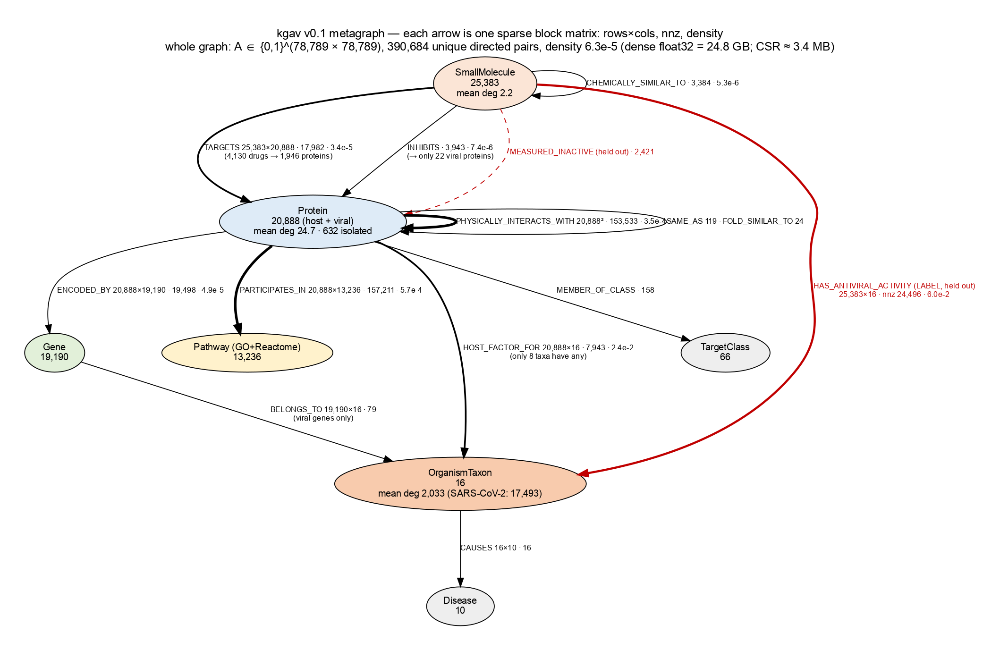
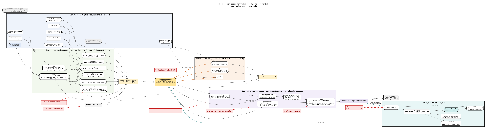

# kgav — how to use the question-answering agent

This guide is for everyone on the team, including people who don't usually work in a
terminal. You type a question in plain English. The agent looks it up in a database
of drug–virus–protein facts (a "knowledge graph"). It prints the facts it found,
each with the research paper it came from, plus warnings about how far to trust them.

- It runs entirely on our workstation. Nothing is sent to the internet.
- There is no web page yet. Everything happens in a terminal window.

---

## 1. What the system looks like

### The graph (what facts it holds)

Each bubble is a kind of thing, with how many of them we have. Each arrow is a kind
of relationship, with how many we have.



In plain words:

| Thing | How many | Example |
|---|---|---|
| Small molecules (drugs and test compounds) | 25,383 | nirmatrelvir, remdesivir |
| Proteins (human and viral) | 20,888 | the SARS-CoV-2 main protease "nsp5" |
| Genes | 19,190 | |
| Biological pathways | 13,236 | "autophagy" |
| Viruses | 16 | SARS-CoV-2, Zika, Dengue 1–4 … |

The red arrow, "has antiviral activity against", is the lab result the system is
graded on. It is kept separate from the reasoning on purpose.

### How the pieces fit together

Public databases (UniProt, ChEMBL, STRING, BioGRID, NCATS …) → cleaned and joined
into one graph → the agent answers questions from that graph. Red boxes are known
problems that are being fixed (see `docs/audit_2026-11-03_fixes.md`).



Zoomable versions: `figures/kgav_architecture.svg` and `figures/kgav_metagraph.svg`
(open in any browser). The `.dot` files next to them are the source to redraw them.

---

## 2. Starting the agent (step by step)

You only need to copy and paste.

**Step 1 — Open a terminal.**
On a Mac: press `Cmd + Space`, type `Terminal`, press Enter.

**Step 2 — Connect to the workstation.** Replace `YOUR-USERNAME` with the account
Vikas gives you:

```
ssh YOUR-USERNAME@10.10.48.150
```

Type your password when asked. Nothing shows while you type; that is normal.

**Step 3 — Go to the project and switch on its Python setup:**

```
cd /home/vikas/projects/kgav
source /home/vikas/anaconda3/bin/activate kgav
```

(If you are logged in as `vikas`, `conda activate kgav` does the same.)

**Step 4 — Ask a question:**

```
python scripts/kgav_ask.py --no-model "explain how nirmatrelvir works against SARS-CoV-2"
```

The answer appears in about 10 seconds. To ask another question, press the
up-arrow key, edit the text between the quotes, and press Enter.

**Step 5 — When finished,** type `exit` and press Enter.

---

## 3. Two ways to ask

| Mode | Command starts with | Speed | What you get |
|---|---|---|---|
| **Facts only** (recommended) | `python scripts/kgav_ask.py --no-model "…"` | ~10 s | The facts and warnings, same output every time |
| **Facts + written answer** | `python scripts/kgav_ask.py "…"` | ~40 s | Also a paragraph written by an AI model (Qwen 2.5, running locally) |

In "written answer" mode, every sentence the AI writes is checked against the facts.
If any sentence is not backed by a fact, the paragraph is **withheld** and you see
`ANSWER WITHHELD — FAILED VERIFICATION`. That is the safety check working, not a
crash. The facts above it are still correct. This happens fairly often today.

---

## 4. Questions that work well

Copy any of these:

```
python scripts/kgav_ask.py --no-model "explain how nirmatrelvir works against SARS-CoV-2"
python scripts/kgav_ask.py --no-model "explain how remdesivir works against SARS-CoV-2"
python scripts/kgav_ask.py --no-model "what evidence links nirmatrelvir to SARS-CoV-2"
python scripts/kgav_ask.py --no-model "explain how remdesivir works against Zika"
python scripts/kgav_ask.py --no-model "profile of molnupiravir"
python scripts/kgav_ask.py --no-model "which pathways does remdesivir touch"
python scripts/kgav_ask.py "which compounds should be considered for Zika"
```

The last one shows the agent **refusing on purpose**. It will not invent new drug
candidates, because testing showed it cannot do that reliably.

Question styles it understands:

| You want | Start the question with |
|---|---|
| How a drug might act on a virus | "explain how DRUG works against VIRUS" |
| The raw evidence for a claim | "what evidence links DRUG to VIRUS" |
| Everything about one drug | "profile of DRUG" |
| Biological pathways involved | "which pathways does DRUG touch" |
| Compare drugs you already have | "rank DRUG1, DRUG2 and DRUG3 for VIRUS" |

---

## 5. Naming viruses (important)

The agent only recognises the names below. **If it does not recognise the virus, it
quietly answers about SARS-CoV-2 instead.** It does warn you, under `VIRUS ASSUMED`
in the caveats, so always check for that line.

| Virus | Write it as (any of these) | Does **not** work |
|---|---|---|
| SARS-CoV-2 (COVID-19) | `SARS-CoV-2`, `sarscov2` | "covid", "coronavirus" |
| SARS-CoV (2003 SARS) | `SARS-CoV`, `SARS-CoV-1` | "SARS" alone |
| MERS | `MERS-CoV`, `MERS coronavirus` | "MERS" alone |
| Common-cold coronaviruses | `HCoV-229E`, `HCoV-NL63`, `HCoV-OC43`, `HCoV-HKU1` | |
| Zika | `Zika`, `Zika virus` | |
| Dengue (4 types) | `DENV-1` … `DENV-4`, `dengue virus 2` | "dengue" alone (ambiguous: 4 types) |
| West Nile | `West Nile`, `West Nile virus` | |
| Yellow fever | `Yellow fever` | |
| Japanese encephalitis | `Japanese encephalitis` | "JEV" |
| Tick-borne encephalitis | `TBEV`, `tick-borne encephalitis` | |

Drugs are found by their common names (for example "nirmatrelvir", "remdesivir",
"molnupiravir", "baricitinib").

---

## 6. How to read the output

The answer comes in labelled blocks:

**EVIDENCE** — the facts found. Each line looks like:

```
nirmatrelvir inhibits the viral protein nsp5 (IC50 75 nM, potent)
  [chembl, PMID:34798775 …, 2021; E83e08310cff11af7]
```

- `IC50 75 nM` — how much drug is needed. **Smaller is stronger.** Under 1,000 nM is
  potent; over 10,000 nM is usually counted as inactive.
- `chembl` — the database the fact came from.
- `PMID:34798775` — the research paper. Search that number on pubmed.ncbi.nlm.nih.gov.
- `2021` — the year the fact was first reported.
- `E83e…` — the fact's ID in our graph (for the technical team).

A "Route" is a chain of facts, for example: *drug → blocks a viral protein → that
protein belongs to the virus*.

**CAVEATS** — warnings. Read them; they are part of the answer:

| Label | What it means |
|---|---|
| `VIRUS NOT VALIDATED` | Our tests found the system cannot rank drugs better than chance for this virus. Treat the facts as facts, not as a recommendation. |
| `VIRUS ASSUMED` | It did not recognise your virus name and answered about SARS-CoV-2. Rephrase using section 5. |
| `ANSWER SHEET` | This fact is a lab result we use to grade the system. It is real data, but not a prediction. |
| `SELECTIVE` | The drug's toxic dose is much higher than its useful dose (good). The number is the ratio. |
| `WEAK` | The potency is above 1,000 nM. |

**REFUSED** — the agent declined, and says why. Usually the question asked it to
predict new drugs.

**ANSWER WITHHELD** — see section 3. The facts shown are still valid.

---

## 7. What it can and cannot do

**Can:**
- Show, with sources, how a known drug is linked to a virus.
- Gather all facts about a drug in one place.
- Compare drugs you already have in mind.

**Cannot (yet):**
- Recommend new drugs. Testing showed its ranking is no better than chance, and a
  simple "most-studied drug first" rule does better.
- Answer about viruses outside the list in section 5.
- Prove that a drug works in patients. The facts are lab measurements.

---

## 8. If something goes wrong

| You see | Do this |
|---|---|
| `conda: command not found` or `python: command not found` | Run `source /home/vikas/anaconda3/bin/activate kgav` again |
| `No such file or directory` | You are in the wrong folder: run `cd /home/vikas/projects/kgav` |
| A note about Ollama / the model not reachable | Use `--no-model`, or ask Vikas to run `sudo systemctl start ollama` |
| `VIRUS ASSUMED` when you named a virus | Use a name from section 5 |
| It sits for more than 2 minutes | Press `Ctrl + C` and retry with `--no-model` |
| The terminal says `note: metapath_comparison.json is absent …` | Harmless message for the technical team; ignore it |

---

## For the technical team

- Entry point: `scripts/kgav_ask.py`; logic in `src/kgav/agent/`. `--json` gives
  machine-readable output; `--show-prompt` prints what is sent to the model.
- Model: Ollama at `localhost:11434`, `qwen2.5:7b-instruct-q5_K_M`, temperature 0.
  Change it with `--model` / `--host`.
- Data: `data/releases/v0.1` (78,789 nodes, 392,907 edges) plus
  `data/results/hard_negatives.json` and `pathway_landscape.json` for the caveats.
- One spot check per virus tier: `make tier-check`.
- Known issues and planned fixes: `docs/audit_2026-11-03_fixes.md`.
