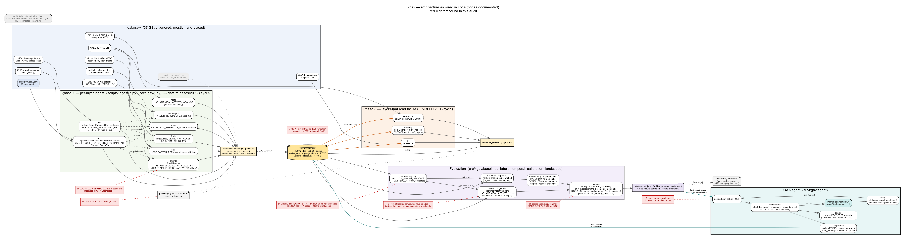
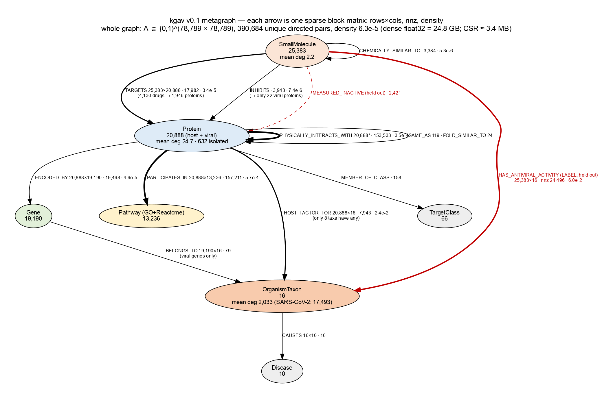

# Changes needed — audit of 2026-11-03

Source: a line-by-line read of `src/`, `scripts/`, `tests/`, `web/`, `config/`, and
measurements taken directly on `data/releases/v0.1` (78,789 nodes, 392,907 edges).
Every item was confirmed against code or data unless marked *(suspected)*.

Diagrams (drawn from the code, defects in red): `docs/figures/kgav_architecture.svg`,
`docs/figures/kgav_metagraph.svg` (PNG versions alongside; `.dot` sources to redraw).

How to run the agent: `docs/agent_guide.md`.

Order of work: **C → B → re-run → docs**. Estimated 3–4 working days in total;
compute is minutes (a results regeneration is about 11 min).

**EVERY FIGURE BELOW IS AS MEASURED WHEN ITS OWN ITEM WAS FIXED, and several
have since moved.** This file is a record of what each fix found, not a
statement about the current release — editing a row to match a later rebuild
would destroy the only thing the row is for, the same reason a
pre-registration is never re-fitted. The L5 rebuild of 2026-11-09 moved the
graph after most of these rows were written (edges 392,624 → 392,363), so a
figure here may be one rebuild behind. **The live numbers are in
`docs/evaluation.md`, `docs/scope_and_limits.md` and
`docs/kg_release_census.txt`, each re-derived by a test on every commit.**
Where a row's figure is load-bearing enough to be quoted elsewhere, the newer
value is given beside it in brackets rather than in place of it.

---

## C. Evidence dates (temporal split is invalid until fixed) — ~2–3 days

| # | Problem | Where | Fix |
|---|---|---|---|
| C1 | ~~Every virus–host PPI edge (12.5k) is dated `2024-01-01`; `--date` help says "fallback when no PMID year", but it is applied to every row~~ **FIXED.** `vhppi.PUB_YEAR_RE` parses the `(YYYY)` in the publication field and `_pub_year` dates each edge by it; `undated_date` replaced the blanket `--date`. 5,222 rows still carry no parseable year and are counted, not dated. //  | `scripts/ingest_vhppi.py:156`, `src/kgav/vhppi.py:424` | Date each edge by its PMID's publication year (PMID already parsed in `parse_row`); fall back only when there is no PMID |
| C2 | ~~All 141,019 STRING edges are dated `2023-08-28` (STRING v12 release date) → `v0.1-train2021` holds **0** `PHYSICALLY_INTERACTS_WITH` edges, so M3/M5 vanish from the temporal evaluation~~ **MEASURED AND DECLARED 2026-11-09, not repaired.** The stated symptom was wrong in one direction and worse in another: the 2021 graph holds **11,744** `PHYSICALLY_INTERACTS_WITH` edges, and **every one is virus–host** (VirHostNet, IntAct, MINT, DIP). All 141,019 host–host edges are STRING's and **0** survive, because STRING publishes no per-interaction date. So M3 (virus–host middle hop) runs and M5 (host–host) cannot — which is why M5 was absent from every SARS-CoV-2 temporal table ever published. `temporal_split.py` now writes `training_graph_predicates` and `training_graph_predicate_sources`, so this is a recorded fact rather than one that had to be walked by hand. **Not repairable offline:** STRING v11.0 (2019) is a 139 MB download and `data/raw` is hand-populated |
| C3 | ~~All GtoP `TARGETS` edges dated `1970-01-01` (= "undated") → always kept in the training graph~~ **MEASURED AND DECLARED 2026-11-09, not repaired.** Confirmed: 5,306 undated `TARGETS` edges enter the 2021 graph under the default `include` — 3,601 GtoP, 1,564 ChEMBL, 141 both — and `undated_census` in the temporal output now names them by predicate and source. **The proposed fix has no offline source.** GtoP edges carry PMIDs but no years, and a PMID→year index derived from the release is UNSOUND: 42.9% of PMIDs get different years from different dated edges, with spreads up to 41 years, because `first_asserted_date` on a merged edge belongs to no single publication in its list. Dating them by the GtoP release date (2026-10-12) would drop all 3,601 from every pre-2023 training graph, which is a protocol change after seeing the numbers and belongs in a prereg |
| C4 | ~~All 3,384 similarity edges dated 1970 and computed over the *full* compound set → post-cutoff compounds leak into the 2021 graph (M6/M7)~~ **FIXED 2026-11-09, and it was holding up every temporal result.** `kgav.temporal.derived_year` dates an undated COMPUTED edge by the later of its endpoints' first appearances. Measured: of 3,173 computed edges, 2,864 are datable and **1,412 (44% of the layer) were post-cutoff**. Effect: SARS-CoV-2 reachable test compounds **231 (14.7%) → 64 (4.1%)**, evaluable viruses **7 → 3**, COMBINED AUC 0.526 [0.503, 0.549] → 0.509 [0.486, 0.532], degree 0.555 → 0.516, and **all five temporal cells whose interval excluded chance are gone**. `exclude` gained two evaluable viruses, because 1,452 computed edges are now genuinely dated pre-cutoff rather than discarded as dateless |
| C5 | ~~Fold edges dated 1970 with source `infores:interpro` are not treated as "computed"~~ **FIXED.** All 24 `FOLD_SIMILAR_TO` edges now carry `infores:kgav-computed`, which is in `temporal.COMPUTED_SOURCES`, so `computed_only` keeps them. Verified in the release. //  → dropped under `computed_only` | `src/kgav/folds.py:712,766`, `temporal.COMPUTED_SOURCES` | Add the folds source to `COMPUTED_SOURCES`, or date them |
| C6 | ~~5,306 undated `TARGETS` kept under the default `--undated include`~~ **MEASURED 2026-11-09; the policy change is a prereg decision.** The 5,306 are now counted by source in `undated_census`. Making `computed_only` the default is defensible and would be chosen after seeing that `include`'s one chance-clearing result was a leak, which is exactly the ordering this project forbids. See C3 |
| C7 | ~~`temporal_split.py` never calls `metapath_reach`; a channel with zero paths is silently skipped (`if sc:`)~~ **FIXED 2026-11-09.** A channel that scores nothing now records a `not_evaluated` block with its metapath, the training graph's edge count for each of its predicates, the per-source breakdown, and which predicates are missing — so "never ran" is distinguishable from "ran and found nothing". The reason text says only what the census supports: M5's predicates are all present and its host–host subset is not, which the source breakdown shows and a predicate-level count cannot |
| C8 | ~~`hard_negatives.py` temporal column applies no overlap policy (compounds measured on both sides of the cutoff)~~ **FIXED 2026-11-09, and the file was REPORTING the policy it did not apply.** Worse than an omission: `hard_negatives.json` has been writing `train_split: {"overlap_policy": "drop-from-test"}`, read off the **training graph's** stamp — which records how `temporal_split.py` cut the GRAPH — beside a temporal column whose labels come from `build_labels(year_from=cutoff+1)`, which knows nothing about a cutoff beyond a year window. The field was true of a different artifact, so the file read as audited and no reader could tell. The loop is now `temporal.drop_already_known`, called by both `build_split` and this script, for the reason `_filter_labels` already exists in that file: a second hand-written copy of a loop is how two sides come to differ without anyone deciding they should. `temporal_notes` records `overlap_policy` and `already_known_dropped`, so a named policy that dropped nothing is distinguishable from one that was never applied. The pre-cutoff side is deliberately **unrestricted by source and selectivity** — "already known" is a fact about the literature, not about which screen a run chose to label from — which is also the conservative direction and what `build_split` compares against. **And the comment justifying the policy was measurably false.** `build_split` read "All 19 agreed on polarity across both sources, which is why dropping them costs no information". Re-derived on v0.1 at cutoff 2021: the overlap is **32** (virus, compound) pairs, all SARS-CoV-2; **18** agree and are dropped (5 positive, 13 negative labels); **14 DISAGREE — every one inactive before the cutoff and active after — and the loop never dropped those**, because it matches positives against train positives and negatives against train negatives, so a changed answer survives. The code was right and its stated reason was not, which is the harder of the two to notice. **The 14 are a protocol question, not a bug:** they are the hardest prospective cases the split holds and also the ones whose pre-cutoff answer is in the literature and wrong, so the behaviour is unchanged, said out loud in `evaluation.md` and `build_split`, and re-derived by `tests/test_overlap_policy.py` — which parses the counts **out of the comment and out of the document** and compares them with the release, because the only record of the old measurement was the sentence making the claim. **Measured effect, all five protocols regenerated in one process (8:34):** cross-sectional **unchanged in all five**; temporal moves only for SARS-CoV-2 — row 1 drops 13 negatives and moves 7 cells, row 2 drops 5+13 and moves 7 (degree 0.5114 → **0.5163**, COMBINED 0.5048 → **0.5087**), rows 3 and 4 drop 1 and move 3 (row 3 degree 0.4973 → **0.5021**, COMBINED 0.4852 → **0.4900**), and **row 5 — the published protocol — moves nothing**, because every `ncats-opendata` label is dated ≤2021 and its temporal test set is empty (`empty_label_set: true`). Rows 1, 3 and 4 drop fewer than row 2 because the selectivity filter removes some of the overlap from the test set before the policy sees it. Note the DIRECTION: removing already-known compounds makes **degree look better**, not worse. 0 of the 25 live document figures moved — they come from `temporal_2021_*.json`, whose pipeline already applied the policy. Adjacent correction found while checking for other copies: the shared-PMID confound reads **92.0% (1,020/1,109)** [**89.3% (787/881)** after the L5 rebuild] in `evaluation.md` and `baselines.py` but **92.2%** in `diagnose_label_overlap.py`, `pathway_landscape.py` and — of all places — the docstring of `tests/test_label_overlap_figures.py`, the test that derives the live one. One release stale; the two inner docstrings now carry no number at all. `prereg_partial_degree.md` keeps its 92.2%, which is what a pre-registration is for |

## B. Label reachability (why every channel sits at AUC ≈ 0.5) — ~1 day

Measured: **13,916 of 19,506 labelled compounds (71%) have no edge besides their label**.
Of those, only **1,409** have any human target at pChEMBL ≥ 6 in ChEMBL 37 (any phase).
The rest are screening compounds with no known target; no data source fixes them.

| # | Problem | Fix |
|---|---|---|
| B1 | `host_targets` keeps only `max_phase ≥ 2` drugs. **MEASURED 2026-11-10 — still the owner's decision, but no longer in the dark, and the row's own estimate was counting nothing that matters.** The row said *"recovers ≤1,409 compounds"*. **"DROP THE PHASE FILTER" IS AMBIGUOUS BY THREE ORDERS OF MAGNITUDE**, because the gate is `md.max_phase >= ?` and `NULL >= 0` is NULL in SQL — so `--min-phase 0` does **not** drop it, it keeps excluding every compound ChEMBL never put in a trial, which is almost all of them. Three readings, measured by `make diagnose-phase-gate`: **(B)** `--min-phase 0` adds 5,761 rows and 470 compounds, of which 70 already in the graph gain a route and 67 carry labels (3 positive); **(C)** no gate at all adds **1,304,767 rows and 678,985 compounds, 676,997 of them brand-new nodes** — a 27× increase on the graph's 25,383 small molecules; **(D)** any phase but only for compounds the graph already has: 1,988 compounds, **0 new nodes**. The added-row figure cross-checks `gate_census`'s independently recorded `dropped: max_phase below 2` exactly. **C AND D ROUTE THE SAME COMPOUNDS — 1,327 gaining a first `TARGETS` edge, 1,179 of them labelled, 300 positive — because `routed` is by definition the in-graph subset.** So everything B1 buys for any AUC is available at zero new nodes; C's 676,997 extra compounds buy candidate pool, which is a different claim. The recovered rows are not a disconnected fringe: they reach 3,547 human proteins, 3,538 already in the graph and **1,393 of them host dependency or restriction factors**, which is the M2 channel. **AND OPTION D IS NOT A FLAG.** The 1,327 split 667 from `chembl` and 660 from `ncats`, and `ncats` is built *after* `hosttargets`, so a phase-1 filter sees only half; the rest need the layer order changed. **What the ≤1,409 was:** closest to D's 1,327 routed compounds, but stated as compounds *recovered*, which is 678,985 — the same source-rows-versus-edges confusion that made L9 read 217 where the release said 23. | `src/kgav/host_targets.py` SQL; `scripts/diagnose_phase_gate.py` | **Decision needed:** B is cheap and nearly pointless; D is the one that pays, and costs a pipeline reorder plus a rebuild; C changes what the project is. |
| B2 | ~~Unreached compounds are imputed to the bottom of every ranking, so AUC mostly measures coverage~~ **FIXED 2026-11-09.** `kgav.labels.auc_floor` computes what a given coverage scores with no ranking skill (`0.5 + (cov_pos - cov_neg) / 2`, derived from the pair counting), `auc_skill` the fraction of the floor-to-ceiling span a scorer used, and both are emitted beside `auc_ceiling`. Both protocols are now decomposed in `docs/evaluation.md`, pinned by `tests/test_auc_decomposition.py`. **Cross-sectional:** 89% of COMBINED's margin above chance is coverage asymmetry and 0% of degree's is, since degree ranks every compound; normalised, every scorer uses 11.9–26.3% of its available span and none separates from the others. **Temporal:** 53 of 69 AUC cells equal their floor to four decimal places, median deviation exactly zero, largest 0.0067, largest floor-to-ceiling span 0.0320 — so the tie-safe AUC on that protocol **cannot** separate, whatever scorer is applied. On 2026-11-08 the decomposition showed COMBINED's chance-clearing 0.5263 to be exactly its own floor (ceiling 0.5266); the C4 leak fix put it below the bar the next day, so two independent findings retired the same result. An interim note on 2026-11-08 said the temporal coverages were not recorded — wrong, the fields are `auc_coverage_pos`/`auc_coverage_neg` |
| B3 | **Decision needed:** restate the task as "compounds with a known mechanism" (≈30% of labels) | Owner's call before step 2 |

## L. Label quality

| # | Problem | Where | Fix |
|---|---|---|---|
| L1 | ~~69% of `HAS_ANTIVIRAL_ACTIVITY_AGAINST` edges are measured *inactive* (censored `>`; 7,333 NCATS curve class 4). `labels.py` re-classifies, but the agent and exports read them as active~~ **FIXED 2026-11-09, and the share is worse than 69%.** Re-measured with `classify`: of 26,278 edges, **20,238 are inactive (77.0%)**, 5,525 active, 515 undecidable. [After the L5 rebuild later the same day: of 26,017 edges, 20,239 inactive (**77.8%**), 5,232 active, 546 undecidable — which is what `tools.py`, the schema `doc` and `scope_and_limits.md` now state, derived.] The agent rendered all of them as "{s} shows activity against {o} (EC50 ... nM)", **dropping `relation`** — so "EC50 > 50000 nM", a screen reporting it saw nothing to 50 uM, was presented as evidence of activity with the bound quoted as a potency. `_activity_sentence` now calls `labels.classify` (one implementation, no second copy of the threshold) and renders three distinct outcomes, always with the relation and the potency band. **No test caught this**: both label edges in the agent fixture are active, so 442 agent tests passed over it; `tests/test_agent_activity_sentence.py` exercises every branch and asserts the release still contains the case. **The predicate is NOT renamed and the inactives are NOT routed to `MEASURED_INACTIVE_AGAINST`** — the cut is a protocol parameter (`hard_negatives.py --inactive-above-nm`), so routing by verdict would bake an evaluation threshold into the graph's topology. The schema now carries a `doc` saying the predicate means "measured against, active or inactive", pinned to the measured share |
| L2 | ~~645 contradictory ChEMBL (compound, virus) pairs are resolved by SQL row order, not dropped (`labels.py:23` claims they are dropped)~~ **NOT REPRODUCIBLE AS WRITTEN, checked 2026-11-09.** `build_labels` does drop them: 150 (compound, virus) pairs on v0.1 have edges that disagree, all of them excluded and counted in `ambiguous_dropped`, and no `ORDER BY`/`GROUP BY` in `chembl.py`'s activity query collapses a contradiction before it gets there. The real defect was one level down and is recorded as L3: the contradiction inside a single MERGED edge, decided by `POTENCY_FIELDS` order. Fixing L3 took `ambiguous_dropped` from 150 to 114 |
| L3 | ~~1,568 merged edges hold several potency fields and one `relation`; 385 change verdict depending on the field read~~ **FIXED 2026-11-09.** Re-measured on v0.1: 1,578 label edges carry two potency fields and **173** disagree on the verdict — `_potency` returned the first field present in `POTENCY_FIELDS`, so the verdict came from the declaration order of a module constant, and reversing the tuple flipped 118 positives to negatives and 55 the other way. `classify` now returns `None` for a contested edge, which is the rule this module already states for ambiguity and that `build_labels` already applies to compounds whose SEPARATE edges disagree. Effect: active 5,643→5,525, inactive 20,293→20,238, undecidable 342→515, and **ambiguous_dropped 150→114** — 36 compounds were being discarded as self-contradictory on the strength of a verdict chosen by tuple order, so the fix recovers them. The canonical 89-positive protocol is unchanged (the NCATS CPE screen carries one potency field per row). A rebuild confirmed the release byte-identical: `chembl.py` classifies single pre-merge rows, so the contradiction is created by `merge_edges` and only the label predicate is read after it — pinned by `test_the_protein_layer_has_no_contested_edges` |
| L4 | ~~NULL ChEMBL relation becomes `=` (bound read as exact)~~ **FIXED 2026-11-09, and the proposed remedy would have been wrong.** Measured for these taxa on chembl_37: **1,069 rows (2.74%)** carry a value with a NULL `standard_relation`. The fix list said "count and drop"; dropping them discards **912 rows that are inactive whichever way the relation reads** — the negatives this project values most. Exposure: 912 harmless, 153 active-as-`=` but undecidable-as-`>`, 4 a full flip. So the imputation is counted (`relation_imputed`, the same name `host_targets.py` already used, where it is 0), carried on the edge as a schema-declared qualifier, and `labels.imputed_relation_decides` refuses **only the 157 verdicts that depend on it** — derived by asking whether `_verdict` survives reading the relation as a lower bound, not hardcoded to the 10 uM cut, so a run with a gap between the two cuts still behaves. Rebuild: nodes unchanged, edges `f3bb418a89779e94` → `a3232767b2964139`, 392,674 → 392,624, and `undecidable_protein_measurement` 63 → 118 as the protein layer stops routing 55 rows on an assumed relation |
| L5 | ~~Censored CC50 written as exact with `selectivity_verified: true`; MIN/MIN SI is not conservative; tox CTE unrestricted~~ **FIXED 2026-11-09, and the remedy named the smaller half.** The first two parts landed earlier (the retained CC50 and its `exact` flag now describe one row; `selectivity_verified` is true only where both sides NAME the same cell line). What was left was written as "MIN/MIN is not conservative", and measured, that is not the defect. **The antiviral side was not required to be cell-based.** A selectivity index is CC50 ÷ EC50 in one cell system; the query took any EC50 or IC50 filed against these taxa — 5,055 `SINGLE PROTEIN`/B/IC50 and 4,603 `SINGLE PROTEIN`/F/IC50 rows among them — and then kept the **minimum**, which systematically prefers the biochemical reading because an isolated enzyme reads lower than a cell. **861 of 4,241 pairs (20.3%) took their "selectivity index" from a protein assay**, 569 of those in documents holding no cell-based antiviral row at all, and every one was emitted carrying `assay_type: "cell_based_antiviral"`. molregno 2846010 is the shape of it: a 1 nM protease IC50 over a 70,500 nM cell CC50 published **SI 100,714** where the same document's cell-based EC50 of 40,100 nM gives **1.8**. **The obvious gate was the wrong one, and that was measured before it was used.** `assay_type = 'F'` looks like the test for cell-based and is not — a FRET protease assay is functional — so `'F'` and `target_type = 'ORGANISM'` disagree on **4,605 rows, every one a protein assay `assay_type` would have admitted**. They agreed on the rows the old code happened to retain, so they would have looked interchangeable. The gate is `target_type`; `CELL_BASED_TARGET_TYPE` records why. Three ordered steps, each counted on every run: cell-based only (**10,018 of 39,467 rows** dropped) → EC50 from the CC50's own cell line where one exists (2,395 of 3,672 pairs; 1,277 cannot be matched) → the **largest** candidate EC50 (406 pairs have a choice; the within-group spread is median 4.77×, 100× at p90). **Layer effect:** 3,226 → 2,758 edges, **selective 2,212 (69%) → 1,730 (63%)**, cell line verifiable 1,581 → 1,694, median SI 27.50 → 18.59. Rebuild: nodes unchanged, edges `a3232767b2964139` → `8597824ec26a3090`, 392,624 → 392,363 — only 261 of the 468 lost layer edges leave the release, because the rest merge with a ChEMBL activity edge. **IT REACHES THE LABELS, WHICH L5'S STATEMENT DID NOT SAY.** `labels.POTENCY_FIELDS` reads `ec50_nm` first, so the conservative EC50 is the value `classify` sees: measured by running HEAD's module beside the new one over one database, 468 (compound, virus) pairs lose their selectivity edge (**434 of them active**) and on **48 more the label itself flips active → inactive**; the selective/cytotoxic verdict flips on 63. That is why row 2 of the sequence table moves although it applies **no selectivity filter at all** — the layer is a source of labels, not only a filter. Sequence table: M1 0.781 → **0.719**, 0.676 → **0.637**, 0.623 → **0.598**, still falling monotonically with the 3 → 4 collapse intact. **Open for the owner:** whether the edge should carry the conservative EC50 at all, or the best-supported potency (the median of the matched cell-line rows, which this layer already does across documents) with the conservative value feeding only the index. Kept conservative because an edge calling a compound active on its most flattering replicate is the same error in the label as in the ratio, and it moves the positive set in the safe direction — but it is a protocol change to the positive set and not mine to make silently. `tests/test_selectivity.py` gained six tests for the gates and two more that derive the Vero census and the verified share from the layer, both of which were stale prose asserting nothing |
| L6 | ~~434 of 3,384 similarity edges join two keys of the same molecule (same 14-char InChIKey skeleton)~~ **FIXED.** `normalize_chem.skeleton_of_id` + the exclusion in `similarity.py`; the layer went 3,583 -> 3,149 edges. //  | `src/kgav/similarity.py` | Exclude same-skeleton pairs |
| L7 | ~~Degree baseline counts held-out label edges~~ **FIXED.** `Graph.degree_unlabelled` is counted after the held-out skip and `degree_ranking` reads it. Cross-sectional SARS-CoV-2 degree fell 0.616 -> 0.577 and every Hits@k lift collapsed; the prediction in the old code comment said it would RISE and was wrong. //  | `src/kgav/baselines.py:178` | Count degree after the held-out skip |
| L9 | ~~`chembl.py` never reads `activity_comment`~~ **FIXED 2026-11-09, decision taken: the threshold decides and the curator's disagreement rides on the edge.** The field had **0** occurrences in `chembl.py` while curators had written on **17,911 of 39,039** candidate rows. `curator_note()` now classifies it and two qualifiers are emitted on all three ChEMBL label predicates: `curator_verdict` where a verdict was given, and `outside_dose_series` on **every** edge of the layer, false included, so absent (a source with no such field) and false (ChEMBL saying this row is inside its series) stay different claims. On the release: **969** edges carry a curator's *active*, **36** an *inactive*, **4,839** the dose-series flag, 20,055 an explicit false, and 7,432 label edges come from sources with no such field. **The decision is pinned by a test**: a row a curator called INACTIVE at 50 nM is still a positive, because the uniform 10 µM cut in `labels.py` decides and this only makes the disagreement visible. **THE ROW'S FIGURES WERE SOURCE ROWS, AND THE RELEASE SAYS SOMETHING SMALLER:** it reported *"11 rows a curator called inactive are currently POSITIVES"*, which is right about rows — the release has **10** such edges, because edges collapse rows and the ingest drops others. Both scopes are now stated wherever either is quoted. **AND THE CAVEAT WAS EVAPORATING ON MERGE.** The first rebuild counted **652** edges where two sides disagreed about the flag and `LAYER_PRECEDENCE` settled it silently — so an edge could publish `false` while a contributing row was flagged, and a consumer filtering `outside_dose_series == false` would keep exactly the edges the flag exists to expose. `QUALIFIER_LADDER` now ranks `true` above `false`, which is the only direction that cannot mislead: an edge is flagged if ANY row behind it was. After the ladder, `qualifier_precedence_decided:outside_dose_series` is **absent** and `qualifier_kept_more_specific:outside_dose_series` reads **100** — so 552 of the 652 already published `true` and **100 edges flipped from `false` to `true`**. `curator_verdict` has no ladder and needs none yet (zero disagreements on this release) because neither verdict is the more specific claim; a test asserts that counter stays at zero, since the answer there would be CONTESTED semantics rather than a ranking. **The fixture had drifted from the schema it stands in for:** `tests/test_chembl.py`'s synthetic `activities` table had no `activity_comment` column, so selecting it failed every ChEMBL test at once. Rebuild: chembl layer `7b01f75d6616802d` → `70cc2cf4bdebd549`, assembled `edges_sha` `c59bc64295ab95b1` → `f8a1ae20bfd89b37`, `nodes_sha` and all counts unchanged, and the **orcs layer came back byte-identical** after P10's extraction forced it to re-run. All 28 results regenerated: **0 of 28 moved a measured figure**. 18 tests. The protocol question the field opened up is filed as L10 | **Done** |
| L10 | ~~23 ACTIVE labels on the release rest on a potency ChEMBL's own curator flagged as falling outside the tested dose series~~ **DECIDED 2026-11-09, option (b) chosen by the owner: keep them and make the alternative runnable.** `activity_comment` is mostly not a verdict — of 39,039 candidate rows, 21,128 carry no comment, 9,200 a replicate count, **6,736 the dose-series flag**, 1,022 *active*, 36 *inactive*, 917 other prose, 697 distinct strings in all. A flagged value is an extrapolation past the concentrations tested, not a reading from them. **ON THE RELEASE, WHICH IS THE SCOPE THAT MATTERS:** **4,839** label edges carry it — 4,691 inactive, 125 undecidable, **23 ACTIVE**. **"A CONSUMER CAN FILTER" IS ONLY TRUE IF SOMETHING CAN**, so option (b) is not the status quo with a sentence attached: `labels.build_labels` gains `dose_series_policy ∈ {include, exclude}` and `hard_negatives.py` a `--dose-series-policy` flag, defaulting to the decision. Measured across the switch: positives **5,115 → 5,092** and negatives **18,537 → 13,846**, which cross-checks the edge census exactly — 23 positives and 4,691 negatives, derived twice by different routes. **THE DEFAULT IS THE DECISION, NOT THE ABSENCE OF ONE:** `include` reproduces every figure published before the parameter existed, a misspelling is **refused** rather than read as `include` (the rule `temporal.build_split`'s `undated_policy` already states), and BOTH branches count — an `include` run that said nothing would leave 4,839 labels invisible at exactly the point they become labels. **AND THE POLICY REACHES BOTH SIDES OF THE TEMPORAL SPLIT.** It is passed to all three `build_labels` calls in `hard_negatives.py`, including the pre-cutoff and test sets, for the reason the comment beside them already gives about the selectivity filter: a protocol applied to one half of a split is not the protocol anybody asked for. Recorded in every results file it writes, so no figure there is readable without knowing which protocol produced it. Documented in `evaluation.md` under `<!-- FIGURE: dose_series_cost -->` with all five figures re-derived from the release by a test, and as a named limit in `scope_and_limits.md` — *"every AUC rests partly on extrapolated potencies"*, stated rather than left to be discovered. **What is lost either way:** the flag is a fact about one source row and an edge collapses rows, so a flagged edge means AT LEAST ONE contributing row was extrapolated, not that all were — the sticky-caveat semantics L9 chose. The replicate-count thread stays open under L11. 6 tests | **Done** |
| L11 | **ChEMBL states its own replicate count in `activity_comment` and the graph's `potency_n` counts something else.** Split out of L10 rather than carried inside it. 9,200 candidate rows say `No. Measurements = N` — **8,736 of them `= 1`** — which is the source's statement of how many measurements are behind its value. `potency_n` (fix-list P13/P14) counts the rows **this project** collapsed onto one edge, so an edge gathering three rows that each say `= 1` reads `potency_n = 3`, and an edge carrying one row that says `= 8` reads `potency_n = 1`. Neither number is wrong and nothing on the edge says which is which, so a reader asking "how many times was this measured?" gets an answer to a different question. `curator_note` already classifies these rows and deliberately returns no verdict for them, so the parse exists; what is missing is a decision about whether a second count belongs on the edge (a `source_measurements` qualifier) or whether `potency_n` should be renamed to say what it actually counts — the cheaper and arguably more honest fix, and a schema rename that touches P13's four qualifiers and every document quoting them | **Decision needed** |
| L12 | ~~The release manifest's `dirty` flag can never be `false`~~ **FIXED 2026-11-10, and the row exists because I quoted the flag as evidence before checking it.** `provenance.code_commit` excluded `data/results` from its `git status` for a reason its own comment spells out at length — writing those files is what its callers do, so the first one written dirtied the tree and 13 of 14 stamps on the 2026-10-16 run read `True`. **That fix stopped one directory short.** `assemble_release.py` writes `data/releases/v0.1/MANIFEST.json`, the ONE tracked file under `data/releases` (`edges.jsonl` and `nodes.jsonl` are gitignored), on its first pass and stamps again on its second, by which point the file it wrote differs from `HEAD`. **AND IT WAS NOT USUALLY TRUE, IT WAS ALWAYS TRUE:** a manifest records `HEAD`'s hash and is committed afterwards, so its committed copy always names the *previous* commit and can never equal what the next build writes — there is no sequence of commits that reaches `false`. Measured: **7 of 7** committed versions in history say `dirty: True`, each naming the commit before its own; live, `git status --porcelain -- ':(exclude)data/results'` listed exactly ` M data/releases/v0.1/MANIFEST.json` and nothing else. **THE COST WAS NOT THE FIELD.** Reading the stamp after the merge I told the owner it was *"doing exactly the job it exists for, telling a reader not to trust the commit alone"*. It cannot do that job. What actually showed the L9 build ran on uncommitted code was the *commit* field beside it and the branch history — a value true by construction reads exactly like a measurement and gets cited as one. **THE FIXTURE IS WHY NOTHING CAUGHT IT:** `_repo` called itself "a miniature of this repository's layout" and modelled only the directory the previous fix had already handled, so every test here passed while the manifest went on dirtying its own stamp. **THE FIRST HONEST `True` THIS FIELD HAS PRODUCED:** the re-stamp rebuild ran with seven modified source files in the tree and reported `dirty: True` for that reason rather than for its own. Graph byte-identical across both rebuilds — `edges_sha f8a1ae20bfd89b37`, `nodes_sha 3356fae68afdf18d` — so the exclusion changed the stamp and nothing else. Documented in `evaluation.md` under `<!-- FIGURE: dirty_flag_releases -->` with the 7-of-7 count re-derived from git history by a test that also asserts the structural argument still holds: no committed manifest names its own commit. | `src/kgav/provenance.py` `GENERATED_PREFIXES`; `tests/test_provenance.py` `_repo` **AND THE FIGURE WAS WRONG IN ITS FIRST DRAFT, CAUGHT BY ITS OWN TEST'S POPULATION RULE.** It read 6 of 6, counted before a seventh manifest version was committed an hour later, and the test preserved it: the population was cut at a commit *subject*, naming the commit that DOCUMENTED this finding rather than the one that fixed it, so test and document agreed by being wrong together — the same shape as "a check written with the same literals it is checking". The population is now derived by asking git whether each commit's own `provenance.py` carried the exclusion yet, so it shrinks for the right reason and never needs editing. | 5 tests, 3 proven to fail with the exclusion removed | **Done** |
| L13 | ~~`rebuild_release.py` asserts that results are stale instead of measuring it~~ **FIXED 2026-11-10.** Every rebuild ended *"Results in data/results were computed from the previous release and are now stale"*, which is false of the one run a reader most needs it right about: the 2026-11-10 re-stamp rebuild came back byte-identical and `check-results` reported **27 current, 0 stale, 1 refused**. Now `staleness_verdict(before, after)` over two `release_fingerprint` dicts taken around the run, with four branches — no release beforehand, no release after (which should not happen and says so), unchanged, changed — and the real run printed *"This run did not change the release (edges_sha f8a1ae20bfd89b37), so it made nothing in data/results stale."* **THE SCOPE IS NARROWER THAN THE GOOD NEWS, AND THE WORDING KEEPS IT THERE:** an unchanged release proves THIS RUN staled nothing; it says nothing about whether an earlier run already had, since only `check_results.py` reads each file's own stamp — so the pointer to it survives in all four branches and no branch claims the files are current. **A PURE FUNCTION BECAUSE THE ALTERNATIVE IS A SENTENCE ONLY A 7-MINUTE REBUILD CAN EXERCISE**, which is how the wrong one survived; `None` is handled explicitly rather than by equality, since a fresh checkout has no release and `None == None` would have read as "unchanged". Needed `pipeline.release_dir` so the fingerprint and `assemble_release.py`'s `--out` cannot drift onto different directories — read off an extracted `build_parser` rather than grepped for, and the other nine copies of that path are filed as L14 rather than fixed on the way past. | `scripts/rebuild_release.py`; `src/kgav/pipeline.py`; `scripts/assemble_release.py` | 6 tests, 4 proven to fail against the old sentence or a naive equality check | **Done** |
| L14 | **The assembled release's path is written out by hand in ten places.** Found while fixing L13, which needs `rebuild_release.py` and `assemble_release.py` to agree on where the release is — they now both read `pipeline.release_dir`, and that part is closed. The other nine are `--release` argument defaults: `check_results.py`, `run_baselines.py`, `ingest_selectivity.py`, `ingest_similarity.py`, `write_kg_report.py`, `data_audit.py`, `diagnose_controls.py`, `diagnose_orphans.py`, `diagnose_scorer.py`. **The risk is lower than it looks and should be stated as such rather than inflated to justify the work:** all nine READ where `release_dir` says WRITE, so a drift makes them fail loudly on a missing directory instead of quietly measuring the wrong one — which is the failure mode L13 actually had. So this is tidying, not a defect, and it is filed rather than done because nine mechanical edits made on the way past something else is how unrelated breakage enters a commit. | ten `--release` / `--out` defaults across `scripts/` | Point each default at `pipeline.release_dir(root)`. Worth doing in one pass with a test that reads each parser's default rather than grepping for the literal — the reason `build_parser` was extracted from `assemble_release.py` and from `fetch_raw.py` before it. **Open** |
| L15 | ~~Two figure sets around `host_targets` were stale, and neither was mismeasured~~ **FIXED 2026-11-10, found while measuring B1 rather than by looking for it.** **(i)** `scope_and_limits.md` said the analysable set was **3,002** molecules, 11.8%, partitioned 633 / 1,046 / 58 / 108 / 20,536 with a curated ceiling of 1,679. The release says **4,130**, 16.3%, 520 / 973 / 35 / 95 / 19,630, ceiling 1,493 — every one of the eight wrong. **The cause is not an error but a new source:** the GtoPdb layer began contributing `TARGETS` edges (3,601 of its own, 3,164 shared with ChEMBL) and 1,128 more molecules became analysable while the paragraph stood still. **(ii)** `host_targets.py`'s own SCOPE docstring said *3,667 drugs, 63,826 activities, 1,670 targets*; the query returns 3,022 / 58,817 / 1,646. **The cause here was measured rather than guessed:** re-running the same query with the `standard_type IN ('IC50','EC50','Ki','Kd')` gate removed returns exactly 3,667 / 63,826 / 1,670, so those figures were right before that gate existed and nothing re-derived them after. **THIS IS THE ROT `evaluation.md` ALREADY WARNS ABOUT, CAUGHT IN THE ACT** — *"the numbers written in this document's prose carry no such stamp, so they rot silently"* — and it rotted in the FAVOURABLE direction, which is why no reader would have questioned it. Set (i) is release-derived, so all eight figures now come from a test under `<!-- FIGURE: analysable_set -->`, proven to fail against the old ones. Set (ii) needs the 30 GB gitignored sqlite, so it is recorded with its date and the gates it depends on, and `make diagnose-phase-gate` re-derives it in ~20s. | `docs/scope_and_limits.md`; `src/kgav/host_targets.py` SCOPE | 1 test (8 figures) | **Done** |
| L16 | ~~`test_kg_audit_report.py` passed only when another test file had run first~~ **FIXED 2026-11-10, found because an unrelated change made it fail.** `undescribed_curators()` imports `scripts.write_kg_report`, `scripts/` has no `__init__.py`, and this file put only `src` on `sys.path` — so the import worked solely because five other test files insert the repository ROOT at import time and one of them sorts earlier. `pytest -q tests/test_kg_audit_report.py` failed with `ModuleNotFoundError` while the full suite passed. **It surfaced for the wrong reason, which is the point:** adding `scripts/diagnose_phase_gate.py` broke `test_the_entry_point_count_is_the_number_of_entry_points` (62 → 63 entry points, correctly — the report's layout paragraph is hand-maintained and that test derives the count from the filesystem), and running the file alone to check it exposed this. Verified pre-existing in a detached worktree at `HEAD` before touching it, since the first comparison I made was invalid — `python -m pytest` puts the cwd on `sys.path` and bare `pytest` does not, so it appeared to pass at `HEAD` when it did not. **A test that passes only when a different file ran first is not passing for the reason it states**, and the fix also un-skipped a second test in the same file that was being silently skipped: 56 passed / 1 skipped / 1 failed → **58 passed**. | `tests/test_kg_audit_report.py` import block; `docs/kg_audit_report.txt` layout paragraph | one line, with the reason recorded beside it | **Done** |

## E. Statistics and reporting

| # | Problem | Fix |
|---|---|---|
| E1 | ~~No multiple-testing correction across ~150 tests in `compare_metapaths.py` / `temporal_split.py`~~ **FIXED 2026-11-09.** `kgav.baselines.correction_families` derives four candidate families for any run and both scripts emit a `correction` block; `tests/test_correction_families.py` asserts `docs/evaluation.md`'s sensitivity table against it, verdict column included. The four sizes had been typed by hand and nothing could recompute one — three were right, and the fourth, `cells_computed` at 61, had a definition recorded nowhere (cells the run PRODUCED: not cells with a p-value, 34, nor cells planned, 120). Cross-sectional: 10 / 61 / 120 / 150, and only SARS-CoV-2 M7 survives the smallest. Temporal: 2 / 17 / 24 / 30, and no readable cell survives any — while the four significant rows that DO clear the strictest family all fail `trustworthy`, so multiplicity is the weaker of the two gates. **The family is reported, not chosen**: fixing one now, with the p-values on screen, is the ordering this project forbids, so the decision stays in the prereg |
| E2 | ~~`baselines_*.json` Hits@k/MRR depend on tie order; no range flag~~ **FIXED 2026-11-09, and the item's framing was wrong.** It named the two metrics together; measured, they are not comparable: **Hits@k is undetermined in 1 of 120 figures, MRR in 10 of 40.** A tie at the cut is NOT an undetermined figure — 39 of the 120 Hits@k cells have a block straddling k and stay determined because the block holds no positive, so counting ties instead of indeterminacy overstates that half 23-fold (which is how it was first measured here). **MRR is the broken one**, because it reads the FIRST positive's rank, so a tie at the top moves the whole statistic: Zika `dwpc` published 0.3333 over a true range of [0.2500, 1.0000] and DENV-2 `dwpc` 0.3333 over [0.3333, 1.0000]. New `baselines.mrr_range` (none existed; `hits_at_k_range` had covered Hits@k since 2026-10-14), every cell now carries `lo`/`hi`/`determined`, stdout marks one-draw figures with `~`, and `hits_at_k_range`'s annotation is corrected from a 4-tuple to the 5-tuple it always returned. `tests/test_mrr_range.py` pins the arithmetic, the point-inside-range property, and the measured asymmetry |
| E3 | ~~`vs_degree_readable` is True exactly when degree is significant (inverted)~~ **NOT A DEFECT, checked 2026-11-07.** It is true exactly then and that is correct: the flag asks whether the RATIO can be read, and a quotient over a denominator at chance is large because the divisor is small (SARS-CoV-2 M4 reads 2.04x a degree lift of 0.75, p=0.8167, while M4's own lift is 1.53 at p=0.2630). Whether the CHANNEL's result is trustworthy is a different question and is `confound_warning`'s BASELINE AT CHANCE verdict. The two share the words "degree at chance" and one comment in `baselines.py` answered both at once, which is what this item read as an inversion; that comment is now split and three tests pin the semantics. | `baselines.py:924-925` |
| E4 | ~~`pathway_landscape.json` predates the per-row seeding fix; `check_results` still calls it current~~ **FIXED.** The file records `seed_scheme: "per-row: Random(f'{seed}|{channel}|{virus}')"`, and `landscape.py` reports an EMPTY scheme as the old shared-generator run rather than defaulting it away. //  | Re-run; make `check_results` compare the code commit too |
| E5 | ~~`network_proximity` averages observed vs null over different denominators *(suspected)*~~ **CONFIRMED AND FIXED 2026-11-09, and it was three defects, two of them found by a test rather than by reading.** **(1) The stated one.** `closest()` averaged `dist[t]` over the targets REACHABLE from the factor set, so the observed value was a mean over subset S of a drug's targets — while the null drew a degree-matched replacement for every slot in the full set T and averaged whichever of THOSE happened to be reachable. The z-score compared a quantity over S against a null matched to T. It is not a rounding difference, because reachability is wildly uneven across the very bins it matches on: on SARS-CoV-2, **7 of 1,765 proteins are reachable in bin 2^0, 34% in 2^1, 65% in 2^2, 99% in 2^5**. A low-degree target's replacement almost never contributed a term and a high-degree one almost always did. 896 of 3,907 scored drugs (23%) have an unreachable target, 1,574 target slots of 17,725. The pool is now degree-matched **and reachable**, over the slots the observation used, so every null sample has exactly as many terms as the observed mean. Measured with the Monte Carlo noise separated out (per-drug seeding, so unaffected drugs move by exactly zero): median z shift **+0.0000 / +0.0631 / +0.2076 / +0.2574** for 0 / 1 / 2 / 4+ unreachable targets dropped, against a reseed-only control of −0.0108. Every shift is positive — **the old null penalised drugs with unreachable targets**, because the extra terms tightened its spread and so inflated the z-score against them. **(2) The RNG was one stream shared across the drug loop**, and `g.out`'s iteration order is the order `edges.jsonl` was written in, so a drug's null came from wherever the stream had reached. Two drugs with an identical observation over an identical slot scored **0.0978 and 0.1562** by position alone. Each drug now seeds from its own id — as a **string**, because `random.Random` hashes `str` through sha512 while `hash()` of a tuple holding a str is salted per process, so a tuple seed reproduces within one run and not across two. **(3) The pool list was itself in file order, and `rng.choice` picks by index.** The order-independence test still failed after (2): reversing a 23-line fixture moved one drug from 0.1857 to −0.0. Per-drug seeding had not removed the dependency, only moved it from the stream to the pool. Pools and target slots are now sorted. **A degenerate null is refused, not scored 0.0** — `sd > 0 else 0.0` wrote a neutral score for a drug whose null could not vary, and a neutral score ranks above every negatively-scored drug; `by_bin[...] or proteins` silently abandoned degree matching when a bin was empty. Both are counted refusals, costing 4 drugs on MERS-CoV, 5 on HCoV-OC43, 0 on SARS-CoV-2, and 0 respectively. **Published effect, all sixteen files regenerated (2:06), every moved figure `determined: true`:** SARS-CoV-2 Hits@10/50/100 1/2/3 → **1/5/5**; DENV-2 1/2/5 → **0/5/5**; MRR moves on six viruses in both directions (SARS-CoV-2 0.5000 → 0.1667, Zika 0.0067 → 0.0075). Both directions is what a bias correction looks like rather than a uniform improvement. **And my first property test passed for the wrong reason.** It asserted two drugs with the same observation and the same slot score equally — which held while the RNG was shared, because both drew from one stream. Once each drug seeds independently they have independent nulls and differ by noise, correctly; the property only holds for one drug against itself. `tests/test_baselines.py` now compares one drug across two graphs differing only by the unreachable target edge, and adds three more properties: an unreachable protein placed in the target's own degree bin cannot enter the null (six decoys, scores must not move), reversing the release file changes nothing, and a single-member pool is refused. `run_baselines.py` prints all five gates — it had reported "N drugs scored" and nothing about the 223 it did not score |

## D. Docs that contradict the project's own results

| # | Claim | Truth (from `data/results`) |
|---|---|---|
| D1 | ~~`docs/evaluation.md:55` "no scorer excludes chance… degree only cross-sectionally"~~ **FIXED 2026-11-08, and the sentence it replaced became true on 2026-11-09.** The claim block prints the derived census of every cell whose AUC interval excludes chance, asserted both ways by `tests/test_evaluation_table.py::test_the_claim_block_enumerates_every_cell_that_clears_chance`. It was seven cells (five temporal) when derived, which is what made the original wording false; fixing the similarity leak removed all five, so it is now two cells, both cross-sectional, both SARS-CoV-2 — the original words, true for the first time. A sentence that is right today and was wrong yesterday with the same words is the whole argument for deriving it |
| D2 | ~~`evaluation.md:59` "4 of 4, no exception"~~ **FIXED 2026-11-08.** Re-measured: five cross-sectional viruses have a channel at p<0.05 — SARS-CoV-2 (M7), DENV-2 (M1, M4, M5), Zika (M5), West Nile (M4), MERS-CoV (M4, M5) — and degree clears it in one, MERS-CoV. The sentence had counted the viruses where DEGREE was significant. Corrected in `evaluation.md` and in the amendment to `docs/prereg_temporal_auc.md`, which cited it |
| D3 | ~~`evaluation.md:49-69` temporal AUCs~~ **FIXED 2026-11-08.** Every cell of the temporal table was stale by two rebuilds; it is re-derived and now pinned by `tests/test_temporal_table.py`. Two further defects fell out of doing it: the pre-registered AUC bar of 0.586 was computed on the reach count (48) instead of the AUC's own n (`auc_n_pos` 1,580 / `auc_n_neg` 982, where the bar is 0.523), and "degree is at chance on the temporal split" was false — degree read 0.555 [0.533, 0.578] there. Both are recorded in the prereg amendment. **The second one became true again on 2026-11-09**: with the similarity leak fixed degree reads 0.516 [0.493, 0.539], containing chance, so the original claim was right and both the figure and the mechanism offered for it were wrong |
| D4 | ~~`docs/v1_release_plan.md:16-40` node/edge counts and overlap ratios~~ **FIXED 2026-11-09, and it was not a stale-counts problem.** The document the paper is written from asserted a finding the results do not support: it read "0.86–0.94 times the rate ... in every one of the eight taxa ... with matched p from 0.73 to 1.00", while the ratios run **0.00 to 1.36** with **two taxa ENRICHED** (HCoV-NL63 1.36, SARS-CoV-2 1.07) and matched p starting at **0.071**. SARS-CoV-2's naive p is 3.96e-04, not 1.28e-04; counts were 78,782 / 386,192 against 78,789 / 392,624. Every figure came from the 2026-10-28 run and survived four rebuilds — it was the **last results table in the repository with nothing re-deriving it**, because it lives in a planning document rather than `evaluation.md`. **The conclusion survives and weakens:** the naive p still vanishes under degree matching, so the control works, but the overlap is not *depleted* — it is indistinguishable from the matched background in both directions in all eight taxa. `tests/test_release_plan_figures.py` pins the table and refuses to let the depletion claim be reinstated while any ratio exceeds 1.0. Also corrected `scope_and_limits.md`: undated edges 6,287 (1.6%) → 14,838 (3.8%), a rise that is a CORRECTION — VirHostNet's blanket `2024-01-01` across all 12,514 rows (C1) left 5,222 honestly undated instead of confidently wrong |
| D5 | ~~`scripts/diagnose_doc_figures.py` matches figures by value, not by virus/channel → false passes~~ **FIXED 2026-11-09, and it had been vouching for figures this repository retracted the same day.** The matcher flattened every float in `data/results` into one set, so a figure counted as present if its three digits appeared *anywhere* — not beside its own bounds, not on its own cell, not even in its own protocol. The failure was directional: confirmation got EASIER as more results files were written, because any file could supply any digit. The withdrawn temporal COMBINED interval **0.526 [0.503, 0.549]** matched inside `hard_negatives_row2.json` and the withdrawn degree interval **0.555 [0.533, 0.578]** inside `hard_negatives_row1.json` — both cross-sectional files, asked about a temporal claim. A check that confirms a retracted number argues against its own correction. `_numbers()` is replaced by `_cells()`, which yields a figure only where `auc`/`auc_ci_lo`/`auc_ci_hi` sit on ONE dict (at both 2- and 3-place bound precision), and the report prints the cell path — `hard_negatives.json cross_sectional/SARS-CoV-2/COMBINED` — so a mismatch is read, not inferred. **That turned up a live stale figure:** `evaluation.md:40`'s claim block, presented as current, read COMBINED **0.575 [0.512, 0.637]** and "0.002 below degree" while the release gives **0.573 [0.510, 0.635]** and a gap of **0.004** — and the census block TEN LINES BELOW already carried 0.573, so the document disagreed with itself. Nothing caught it because `tests/test_claim_block.py` built its fixture over `CHANNELS + ["degree"]` with `CHANNELS = M1..M8`, so `chans["COMBINED"]` raised `KeyError` and **the COMBINED line was unreachable by every assertion in the file** — the one line of the block that is not a metapath was the one line never checked. COMBINED and degree now sit in the fixture as `NON_CHANNELS`, pinned like any M-channel, plus a test that the stated gap is the subtraction of the two figures beside it. Propagated: COMBINED's `auc_skill` 15.0% → **11.9%**, its coverage share of margin 86% → **89%**, the normalised range "13% to 27%" → **"12% to 27%"**, and 0.5746 → 0.5725 — through `evaluation.md`, two `labels.py` docstrings and `test_auc_decomposition.py`'s own header, i.e. **code comments quoting results, which nothing re-derives**. Remaining 6 absent figures read, all correctly historical: each sentence marks itself superseded ("Before the C4 fix", "That figure was"), two inside blockquotes |

**State the real headline:** ~~degree beats every reasoning channel on every
scored virus.~~ **Re-measured 2026-11-08 and withdrawn.** Degree's apparent
margin was substantially the baseline counting the held-out label edges
themselves (L7). With them excluded, cross-sectional SARS-CoV-2 reads degree
0.577 [0.514, 0.639] against COMBINED 0.575 [0.512, 0.637] — 0.002 apart and
not distinguishable. The real headline is that an eight-channel ensemble and
counting a compound's edges perform identically, and both barely clear
chance.

## A. Agent (`src/kgav/agent`, `scripts/kgav_ask.py`)

| # | Problem | Status |
|---|---|---|
| A1 | ~~Evidence question returned "no edge" because taxa are listed first and edges run compound → virus~~ | **Fixed 2026-11-03** (`orchestrator.py`, tries both orders; agent tests pass) |
| A2 | ~~Reach caveat never loads: `--results` is a file, `labels.measured_reach` expects a directory~~ **FIXED.** `kgav_ask.py:172` passes `args.results.parent`, and `measured_reach` now raises if handed a file instead of silently returning nothing. //  | `kgav_ask.py:147` → pass `args.results.parent` |
| A3 | ~~Triage ranks by selectivity taken from held-out label edges, without the ANSWER SHEET caveat~~ **FIXED 2026-11-09.** Confirmed exactly as written: every selectivity index the agent holds — **2,758 of them on this release, all on `HAS_ANTIVIRAL_ACTIVITY_AGAINST` edges** — is a qualifier of the predicate the schema holds out as the evaluation's labels, and `triage` sorts on it. `_held_out_warnings` already covered a tool that **returns** such an edge; nothing covered a tool that merely **sorts** on one, so the ranking was partly derived from the answer sheet and said nothing. New `guards.held_out_qualifier_caveat` states it under the existing `ANSWER SHEET` label, so `verify.dropped_warnings` enforces it and a model cannot drop it for brevity. **Marked, not suppressed**, for the reason `held_out_caveat` already gives at length: these are real published measurements and triage is defined over compounds the user supplied, so nothing is predicted and nothing leaks — what the order is NOT is independent evidence that the graph would have found them. **Derived, not asserted:** the predicate carrying the index is counted at load (`si_predicate_counts`) and the caveat fires only for predicates the schema actually holds out, so a release whose index sits elsewhere produces no claim about labels — pinned by a test that empties `_held_out` and requires the caveat to disappear. Also pinned: the caveat is **absent** when the order used no selectivity at all, because a caveat attached to everything is one a reader stops reading |
| A4 | ~~"Best direct IC50" mixes Ki/Kd and is not virus-scoped~~ **FIXED 2026-11-09, and both halves are worse together than apart.** `_best_direct_potency` took one `min` over every `INHIBITS` edge the compound had — any virus, and `ic50_nm`/`ki_nm`/`kd_nm` pooled — and `triage` printed the result as *"best direct IC50 N nM"* beside a named virus. Measured on v0.1 over **3,823 (compound, virus) pairs**: **133 reported a potency measured against a different virus**, **4 reported one for a virus whose own edges hold no potency at all**, and **439 reported a Ki or a Kd under the name IC50**. 132 compounds inhibit proteins of several viruses, which is what makes it reachable rather than theoretical. The two defects compound, because a binding constant reads lower than a functional inhibition and the `min` therefore preferred it: `FZNWILPXXNKETO-YADHBBJMSA-N` against HCoV-229E was reported as **18 nM** from a Kd on a SARS-CoV-2 protein, where its own scoped IC50 is **2,560 nM** — 142× too potent, in the wrong units, against the wrong virus. Now scoped by the same `INHIBITS → ENCODED_BY → BELONGS_TO` walk M1 makes (unbounded, because a potency is a minimum over every measurement and not a sample of routes), and chosen by **preference order rather than by value** — which is `labels.POTENCY_FIELDS`' own convention, where `_potency` reads the first field present rather than the smallest number. So an IC50 is reported whenever one exists and a Ki or Kd **only** when none does, named as what it is. Together, 258 pairs change the number they report; 312 genuinely have no IC50 and now say Ki or Kd. Seven tests, the last of which parses all five figures **out of the docstring** and recomputes them from the release — and the first draft of it disagreed by 125 because it conflated "scoped differently" with "changed", which is now two counts rather than one |
| A5 | ~~Caveat check is a substring match (e.g. "evidence" satisfies EVIDENCE)~~ **FIXED 2026-11-09, and the exposure is seven of the nineteen labels.** `dropped_warnings` was `marker not in low` — a bare substring search over the lowercased answer — so a caveat counted as surviving when its label appeared as an ordinary English word. Measured against one four-sentence paragraph that states **none** of the declared caveats (*"The evidence for this compound is a single binding assay. Its selectivity is unknown and the ranking below is calibration-free. This cytotoxic effect was contradicted in a second cell line. The pathway route is thin."*), it satisfied **CELL LINE, CYTOTOXIC, EVIDENCE, CALIBRATION, CONTRADICTED, RANKING and PATHWAY ROUTE** — which are the caveats most likely to be *required*, because they are the ones whose subject matter the answer is about. The enforcement failed hardest exactly where it mattered. **And one label could never be enforced independently at all:** `EVIDENCE` is a substring of `PROXIMITY EVIDENCE`, so any answer carrying the proximity caveat satisfied the evidence-tier one for free. `guards.py` already names that failure in its comment on `held_out_label` — "enforcement that can never bite, which is decoration" — and picked two distinct strings there to avoid it; the same collision existed between two of the labels themselves. Two requirements now: the label must be followed by a **colon**, which is how `Caveat` renders itself, how the warning is shown to the model and what the retry instruction asks for (so it demands nothing new and none of the seven prose cases survives it); and longer labels containing the one being tested are blanked out of the answer first, **derived from `CAVEAT_LABELS`** so a new label that swallows an old one is handled rather than discovered later. A left-hand `(?<![\w-])` stops a word ENDING in the label. The prompt now says the colon out loud, which costs a line and saves a retry — the same reason `dropped_warnings` exists at all. Four tests, all derived over every declared label: none is satisfied by the prose paragraph, **every one is satisfied by its own rendering** (a check nothing can satisfy is a verifier switched permanently off), no containing label answers for the label it contains, and a word ending in a label is not that label. 232 existing agent tests pass unchanged, so no realistic answer was relying on the loose match |
| A6 | ~~`--json` prints answers that failed verification~~ **FIXED 2026-11-09. The two surfaces disagreed about whether an unverified answer may be shown.** `render` withholds it outright — "ANSWER WITHHELD — FAILED VERIFICATION", the findings, and a line saying the evidence is what the graph actually contains — while the `--json` branch printed `out` whole, answer included. The exit code was 1 either way, **which protects a shell `&&` and nothing that reads the JSON**: `jq -r .answer` returned model text that had failed verification, with the failure sitting in a sibling key. `tests/test_agent_llm.py`'s own docstring says "a failing answer is withheld, not annotated" and had only ever been true of one of the two surfaces. The answer is now withheld there too, on the same condition, with an `answer_withheld` key saying why; the findings stay, because they are the diagnostic value of the failure, and so do `facts` and `warnings`, because those are the graph's and not the model's. The branch is extracted as `kgav_ask.json_payload` for the same reason `render` is a module-level function — **the test that matters asks BOTH surfaces about one case and fails if they disagree**, and it could not reach the code while it lived inside `main()`. The fixture is the one `test_failed_verification_withholds_the_answer` already used, which is the point: that test passed throughout while this one would have failed |
| A7 | ~~Refusal says "every scorer performs at chance" without a measurement (`temporal` never passed)~~ **FIXED 2026-11-09, and the test was pinning the defect.** `guards.check` has accepted a `temporal` argument all along and its PROSPECT refusal quotes it; **no caller ever passed one** — the orchestrator supplied `calibration` and `routes` and nothing else — so the only branch a user could reach was `temporal is None`, which returned the bare string *"every scorer performs at chance"*, interpolated into *"the limit is **measured rather than assumed**. Under a temporal split … every scorer performs at chance."* A verdict and a claim that it was measured, from nothing. **And the existing test asserted exactly that**, under the docstring *"absent a measured run, the limit is stated without a number"* — it required no AUC and required the at-chance sentence, treating a number as the only thing that can be unsupported. A verdict with no figure is still a verdict. Now the claim and the figure travel together: three branches state a measurement and say so, and the fourth says none was loaded while still describing the split, because the split is the protocol's **design** and the refusal is unreadable without it — what is withdrawn is the verdict, not the framing. The durable reason survives either way (*compounds enter screening because they are novel chemical matter*), which is asserted so the refusal is never left resting on nothing. **Both ends are now wired and tested:** `GraphTools` takes `temporal=` and exposes `temporal_for`, indexed through the same `_index_calibrations` and the same `_same_virus` rule as the cross-sectional store so the two cannot be keyed differently; the orchestrator passes it; and `kgav_ask` loads the temporal section of the same results file. On the published row 5 that section is empty, so the honest branch runs and says so; on row 2 the refusal now reads *"every scorer performs at chance — the strongest is M4 at AUC 0.510 [0.486, 0.533]"* for SARS-CoV-2 and *"no scorer was even evaluable"* for Zika and DENV-1 |
| A8 | ~~Ollama timeout / bad JSON is uncaught → crash *(suspected)*~~ **CONFIRMED AND FIXED 2026-11-09, measured against four stub servers rather than reasoned about.** With only `urllib.error.URLError` caught: a non-JSON body let **`JSONDecodeError` escape**; a read timeout let **`TimeoutError` escape**; HTTP 500 was handled but told the reader to check whether a service that had just answered was running; and a JSON body with no `response` field **returned `""` as though it were an answer**, so ollama's own `{"error": "model not found"}` printed as an empty ANSWER block with the reason discarded. **The timeout is the sharpest of the four:** the class sets `timeout=180` and catches `URLError`, but a read timeout raises `socket.timeout` — `TimeoutError` since 3.10 — straight out of `urlopen` unwrapped, so the one failure the adapter configures for was the one it did not handle, and it crashed the CLI instead of falling back to the brief. All five paths now raise `ModelUnavailable`, which is the right class for every one of them: its own docstring says the caller should fall back to printing the brief unsynthesised, and that is as true of a garbled reply as of an unreachable socket — a crash loses the brief too. HTTP errors name the status and the model instead of blaming the service, the timeout names its own value and what to raise, and a missing `response` field reports ollama's `error` string. Seven tests over real stub servers, including the positive case, because an adapter that rejects everything never answers |
| A9 | ~~7B model's prose often fails verification → answer withheld~~ **DECLINED 2026-11-09, recorded rather than left open.** This is not a defect, it is the verifier working: `verify.py` reads the model's prose, finds a claim the graph does not support, and `kgav_ask.py` sets `answer = None` with `answer_withheld` rather than printing it. The remedy column said "better prompt, or a bigger model", and neither is a fix to this repository — one is prompt tuning against a 7B checkpoint, the other is a hardware decision. What would be a defect is prose passing verification it should fail, or a withheld answer that looks like an answer, and both are already covered: `test_agent_verify.py` requires every caveat label to be present as a label rather than quoted inside a sentence, and A6 fixed the payload so a failed verification cannot ship an `answer` field. **Nothing measured here changes if a larger model is used — the graph and the verifier are the same.** Reopen if the verifier is ever found accepting unsupported prose | **Declined: the verifier is doing its job** |

## P. Pipeline, ingest and process

| # | Problem | Fix |
|---|---|---|
| P1 | ~~CI runs full `ruff check` → 281 findings → always red (Makefile says 29)~~ **ALREADY FIXED when checked on 2026-11-09 — this row was stale, not open.** `ruff==0.16.7` is pinned in `pyproject.toml` and the rule set is declared rather than inherited: `F, E9, B0, E401, E711, E712, E713, E714, E721, E722`. The reasoning is written out beside it, including the 281-vs-29 discrepancy (the default set grew between versions) and the per-rule count for each exclusion — E402's 54 are scripts inserting `src/` on `sys.path` before importing `kgav`, which is how they are meant to run. `make lint` passes. **One finding did come out of the check, and it was mine:** I had been running `ruff check --select F,E9` by hand all session, which is narrower than the configured set, so a `B007` I introduced in the A4 test passed my command and failed `make lint`. The gate the project configured was the one not being run |
| P2 | ~~`make gate` / CI treat **any** non-zero exit (even an ImportError) as "validator rejected planted errors"~~ **ALREADY FIXED when checked on 2026-11-09 — this row was stale, not open.** `make gate` runs `validate_release.py data/releases/smoke --expect "CONSTRAINT=1,MISSING_PROVENANCE=1,MISSING_QUALIFIER=2"`, and the script compares the exact code counts: **a crash cannot satisfy it, a planted error that stops being detected fails it, and a NEW violation fails it too** rather than hiding behind a total. The script's own comment names the original defect — *"for months the only thing it could prove is that this file does not exit 0, which is also what a broken file does."* Five tests in `tests/test_negative_control.py`, the sharpest being `test_the_makefile_and_this_file_agree_on_what_is_planted`: two copies of the expectation and one check that they match, so editing one to silence a failure leaves the other to fail. Also pinned: a clean release must FAIL the negative control, which is the inverse of the original bug. **Nothing to do; the "P2 before P1" ordering I was carrying was advice about work that no longer exists** |
| P3 | ~~Only `vhppi` resolves secondary UniProt accessions; `normalize_bio.UniProtResolver` is unused~~ **FIXED 2026-11-09, and the remedy the row proposed would have recovered nothing.** Both halves of the problem statement are wrong and the second half of it is right. **"Only vhppi"**: `AliasIndex` is used by `ingest_chembl.py`, `ingest_host_targets.py`, `ingest_orcs.py` and `ingest_vhppi.py` — four of five. **"Use the alias index in … gtop"**: measured, **all 19,313 human single-accession GtoPdb rows join directly**, so that change recovers zero rows; and **0 of the graph's 20,888 `UniProtKB` nodes** carry a secondary or deleted accession, checked against UniProt's own lists. **What was true is that the resolver was dead and so was the data behind it.** `UniProtResolver` was named by nothing but `tests/test_normalize.py` — "reached only by its own test", the phrase this project already used of `declared_taxa` — while `data/raw/refs/sec_ac.txt` (**1,159,114 accessions**) and `delac_sp.txt` (**1,912**) were downloaded on every build and read by no code at all. **The consequence is a conflation, not a lost row:** where a gtop accession failed to join, one counter said `protein_not_in_graph`, which cannot distinguish "this protein is not in our proteome" from "UniProt renamed it and we never noticed" — and the resolver returns exactly that distinction (`primary | secondary | demerged | deleted | malformed`). An unjoined accession is now classified and counted by status; where a secondary accession's primary IS in the graph the row is recovered and the route counted, which is the rule `ingest_interactions` already states three lines below for its compound join — *"a join that recovers edges by a looser key has to be auditable"*. A demerged accession is deliberately **not** resolved (picking one primary depends on which isoform the source meant) and a deleted one stays in the accounting. **Zero rows change on this release and the layer rebuilds byte-identical** (`edges.jsonl` `723146b628bbbf12` before and after) — which is what makes it safe to add now, and why the counters matter more than the recovery: a future GtoP release citing a renamed accession becomes a line of output instead of a silent subtraction. `--refs` degrades to the old behaviour when the files are absent, and says so in one line rather than implying it classified anything. Six tests, including that one |
| P4 | ~~ORCS stores a calibrated `direction` beside an uncalibrated `effect_size` (signs disagree)~~ **FIXED.** `orcs.py:399` multiplies by the same sign; the raw value is kept as `score` so the calibration is auditable. //  | Multiply `effect_size` by the same sign |
| P5 | ~~Shared Disease nodes get the last virus's label ("DENV-4 disease")~~ **FIXED.** `src/kgav/mondo.py` loads real MONDO labels and `ingest_spine.py` uses them. //  | Use the MONDO label |
| P6 | ~~M8 gate admits unknown-vs-unknown catalytic types as a match~~ **FIXED 2026-11-09. Confirmed, latent, and the module's own docstring already forbade it.** `a_nuc = a.catalytic_type in NUCLEOPHILES.values()` is False for both `"unknown"` and `"none"`, so two unknowns fell through to MOTIF mode and came out **allowed-weak with `catalytic_type_match=True`** — the qualifier M8 constrains on, and therefore traverses. `decide_machinery`'s docstring states the distinction and the reason: *"None means the fetch failed. The two produce different types — 'unknown' against 'none' — and conflating them would report a network outage as a chain with no catalytic machinery."* The gate conflated them, so **a failed UniProt fetch would have quietly ADDED M8 hops** rather than removing them. **Two routes reach `unknown` and the second is worse:** `sites is None` is the outage, while `NUCLEOPHILES.get(aa, "unknown")` turns an explicitly annotated nucleophile this module cannot name — a lysine or tyrosine — into the absence of one, which is a property of the data rather than of the network. Either end unknown now refuses, symmetrically, and a role mismatch keeps priority because it says more. **Latent on v0.1:** all 24 cached chains resolve to cysteine (10), serine (6) or none (8), so no pair reaches the branch and the layer rebuilds byte-identical (`edges.jsonl` `84769ad4d26c627d`); the 5 `classes_mixed_catalytic_type` TargetClass nodes marked unknown are a class-level verdict over disagreeing members and never reach `gate()`. Five tests, which are the only thing exercising it — including that `none`-vs-`none` is **still** motif mode, since the polymerase comparison depends on it, and that an unnamed annotated nucleophile reads as unknown rather than absent |
| P7 | ~~`ncats` assumes molar `conc_*` columns~~ **FIXED.** `ncats.top_concentration_nm` reads the unit from the column header; `PLAUSIBLE_TOP_NM` bounds it and the unit is declared on the edge. //  | Infer/verify the unit |
| E6 | ~~Every M8 hop in the graph is the mode the gate itself calls WEAK, and nothing records that~~ **FIXED 2026-11-09, option (a) chosen by the owner: record the comparison and keep the channel.** `folds.gate()` returns `mode` and `strength` and `similarity_edges` discarded both, so `catalytic_type_match: true` meant two different things and the release could not say which. Both are now declared qualifiers on every `FOLD_SIMILAR_TO` edge, and the release reads: **24 edges, 20 `nucleophile/none`** (a shared fold the gate refuses to license because the catalytic residue differs — `catalytic_type_match` false, so M8 skips them) **and 4 `motif/weak`**, which is every hop M8 can walk: SARS-CoV-2 RdRp and SARS-CoV RdRp against Dengue-2 NS5 and Zika NS5. Of the **36** allowed cross-family pairs, **20** are `nucleophile/strong` and **16** `motif/weak`, and **0** of the strong ones reach the release because they are protease pairs whose comparator chains the spine does not build. **M8 IS DELIBERATELY NOT CONSTRAINED ON `fold_strength`**, and the schema says so beside the metapath: adding `strong` there would not tighten the channel, it would delete it — zero hops — which is a claim about whether a shared polymerase motif is evidence at all rather than a schema correction. A reader who disagrees can add one line and lose exactly four hops. **`refused` IS DELIBERATELY ABSENT FROM THE `fold_mode` ENUM:** a refused comparison is not an edge, so an edge claiming one would contradict itself. Checked that the new requirement bites rather than decorating: an edge missing both fails with 2 `MISSING_QUALIFIER`, `fold_mode: refused` fails with `ENUM`, and a typo in the strength fails with `ENUM`. **MY OWN TEST FIXTURE GOT THE MEASUREMENT WRONG FIRST, AND ACCUSED THE DOCUMENT OF IT.** Re-deriving 36/20/16 from the chain cache, I filtered `c.spec.role in SCORE_ELIGIBLE_ROLES and c.active_sites` — copied from a different function — which silently removed every polymerase, since the chains with no annotated nucleophile are precisely the ones that reach MOTIF mode. It derived 20 allowed, all strong, 0 weak, and failed the paragraph. The driver's filter is `usable = [c for c in chains if c.ok]`; a fixture that does not reproduce the driver measures something else, and the comment now says so. `evaluation.md` gains the paragraph under a `<!-- FIGURE: m8_fold_strength -->` marker, with all five figures re-derived from the cache and the release by `test_the_documents_m8_paragraph_is_the_measurement` rather than typed. Rebuild: folds layer `84769ad4d26c627d` → `58a6dd8ef38d9690`, assembled `edges_sha` `75d46e49e6e6af97` → `c59bc64295ab95b1`, `nodes_sha` unchanged, counts unchanged at 78,789 / 392,363, census diff one line, and the **similarity layer held at `4534b5486b3640e1`** — P15 confirmed across an independent rebuild. All 28 results regenerated (17:18): **0 of 28 moved a measured figure**, M8's own rows included, checked leaf by leaf. 4 tests | **Done** |
| P8 | ~~`host_targets` dedups on (drug, target, type), so the kept potency depends on row order~~ **FIXED 2026-11-09, and the defect is the DATE rather than the potency.** The order-dependence was already gone: `ORDER BY act.activity_id` is load-bearing and `query_host_activities`' docstring says why, naming the stake — *"the second would land in a different half of a temporal split"*. And the stated remedy does not work: keying on value/assay produces several edges with identical `(subject, predicate, object)`, which assembly merges anyway, so the choice moves rather than disappears. **What was wrong is that ChEMBL's insertion order decided a field called `first_asserted_date`.** Measured on chembl_37 over 19,020 keys: **766 keep a year LATER than their earliest assertion** (54 of them by ten years or more), **143 keep an UNDATED row while a dated sibling exists** — so the edge takes the 1970 placeholder although the year is known — and **71 change which side of a 2021 cutoff they fall on**. Determinism had been fixed without the choice being made correct. The date is now the earliest of the collapsed rows, counted separately for a year moved earlier and a year recovered from the placeholder, because those are different events. Value, relation and direction still come from the first row by `activity_id`, which is a separate question — see below. **Layer: 453 of 14,381 edges move, 350 earlier and 103 off the placeholder**, undated 2,090 → 1,987. **Through the rebuild** (`edges_sha` `8597824ec26a3090` → `b27dc6dc08d73b5b`, counts unchanged at 78,789 / 392,363 since only dates moved): the 2021 training graph gains **23 TARGETS edges (16,599 → 16,622)** and its undated census falls by 85, which moved every cell of the temporal table — COMBINED lift 2.78 → 2.63 (p 0.1608 → 0.1760), degree 1.04 → 1.01, M3 gaining a `~ties` marker, and the cells equalling their imputation floor 53 → 52 of 69. Six tests, two of them for traps in the comparison itself: `"2014" < "1970-01-01"` is False lexically, so a bare `<` lets the placeholder beat every real year, and a **real** 1970 is a year rather than the placeholder |
| P13 | ~~`host_targets` keeps the potency of whichever row ChEMBL inserted first, and the replicates are not replicates~~ **OPTION (b) DELIVERED 2026-11-09, chosen by the owner: the point stays and the spread travels with it.** Four new `TARGETS` qualifiers — `potency_n`, `potency_min_nm`, `potency_max_nm` and `potency_spread_field` — emitted on **every** edge, including the 11,706 single-row keys where they read `n=1, min==max`; emitting them only for replicates would make their absence mean two things (one measurement, or a layer predating the change) and an absent qualifier is the ambiguity this project keeps paying for. In the release: **13,987 of 17,982 TARGETS edges carry a range, 3,821 of those spanning rows that disagree.** **THE FOURTH QUALIFIER IS THE ONE THAT MATTERS, AND IT WAS NOT IN THE PLAN.** Without it the first three are fix-list A4 under new names: 3,801 of 14,381 (drug, target) pairs carry rows of more than one `standard_type` and merge on `(subject, predicate, object)`, so an unnamed range would describe one quantity on an edge stating two. `potency_spread_field` is declared against a new `potency_field` enum, because "which number does this range describe" is answerable wrongly and a free string would answer it wrongly in silence. **AND I HAD THE MERGE DIRECTION BACKWARDS, with a test that passed on the wrong reason.** `add_layer` merges the incoming edge INTO the existing one and treats the existing side as higher, so the **earlier** layer in `LAYER_PRECEDENCE` wins each qualifier — `gtop` before `hosttargets`. My guard asserted `index("hosttargets") > index("gtop")`, which is true, with an explanation that was inverted. The release test caught it: `MTNBRBDFNSGQKB-GXTWGEPZSA-N → P24941` carried gtop's `ic50_nm` of 1.159999966621399 beside host_targets' `[1.1, 1.1]`, and **544 of 14,381 edges (3.78%)** had a range not containing the field it named. `assemble._drop_orphaned_potency_range` now drops all four at the merge when the named field is absent or outside the range, counted into the MANIFEST as `potency_range_orphaned_by_merge`. Dropped rather than recomputed: the losing layer's rows are not on the edge, so an absent range means "not recorded", which is true. **It turned out to do two jobs rather than one.** The counter reads **551**, not 544, because the collision also happens INSIDE the host-targets layer — `qualifier_precedence_decided:potency_spread_field` fires 4,416 times, where an IC50 row and a Ki row for one pair merge and precedence picks a range against a potency from the other row. The cross-layer measurement could not see that; enforcing the invariant where it can be OBSERVED caught all of it, which is the argument against deriving it from a precedence list. Rebuild: `b27dc6dc08d73b5b` → `c3ae7724ae6d2a08`, counts unchanged at 78,789 / 392,363, every results figure unchanged (landscape differs in three provenance fields, checked field by field). Eight tests, the decisive one checking the invariant **on the assembled release** because the pre-assembly tests cannot see the merge |
| P9 | ~~Stale results dirs `data/results-corrected`, `data/results-prechange`~~ **FIXED 2026-11-09, and both were worse than stale.** 22 tracked files, 888 KB, and nothing read either: every reference in the repository is a comment describing the defect they caused — the Makefile's own *"AUDIT WHAT THE SCRIPTS WRITE. This pointed at `data/results-corrected`"*, plus `test_provenance.py` twice and `test_results_match_the_release.py`. **Why that matters rather than being housekeeping:** `check_dir` audits the directory it is given and the audit is wired to `data/results`, so a sibling full of JSON that looks exactly like results is invisible to it. Checked before deleting: `results-corrected` is stamped to release **73ebb09d59aa58b3 (2026-09-17)**, a release not on disk any more, and `results-prechange` **carries no provenance block at all** — it predates the stamp, so no release and no commit can be attached to those numbers. `kg_audit_report.txt` says `data/results` is tracked *"on purpose: a result that exists only on the machine that produced it is not evidence for anything"*; a result whose release cannot be named is that claim one step further on, and these were in the repository rather than on one machine. Removed with `git rm`, so git history keeps everything that was ever attributable. `tests/test_no_unaudited_results_dir.py` refuses a new `data/results*` sibling — a snapshot belongs inside `data/results` where the audit stamps it, or outside the repository; beside it is the one place where it looks like evidence and is checked by nothing — with a second test that the audited directory still holds results, so the first cannot pass by everything having been deleted |
| P14 | ~~`gtop` writes a `TARGETS` potency and no spread, so 551 merged edges lose the range rather than keeping the right one~~ **FIXED 2026-11-09, and the 551 were the smaller half of it.** `gtop` now collapses its own rows the way `host_targets` does, so whichever potency wins a merge brings the spread belonging to it: `potency_range_orphaned_by_merge` is **absent from the MANIFEST — 0, from 551**. **THE SPECULATION IN THIS ROW WAS WRONG AND THE MEASUREMENT CAUGHT IT.** I filed it saying GtoPdb's `Original Affinity Low nm` / `High nm` columns "may give the range directly rather than by collapsing rows". They cannot: of the 14,066 rows in the 2026.3.1 export that state a usable median, **0** state a low or a high, and the 940 rows that do state one state no median — there is no row in the export where the two coexist, which `test_gtop.py` re-derives from the download rather than quoting. That is what makes the fix safe: the range is counted from collapsed rows in **both** layers, so `potency_n` means one thing graph-wide — one source record, `n=1` implying `min == max ==` the point — which is the conflation this row was filed to prevent. Had those columns been usable, one record could have carried a span and `n=1` would have meant two different things in the two layers. **AND THE DROP COUNTER WAS SEEING LESS THAN HALF THE DEFECT.** Reconstructing the pre-fix merge pair by pair over the two layer files: **850** shared triples published `gtop`'s point beside `host_targets`' rows. ~529 of them failed containment and were dropped (the MANIFEST's 551; the remainder arise inside the assembly, where identity resolution collapses subjects the layer files state separately) — and **~321 passed containment and were published**, a range describing rows the surviving number was never measured in, counted nowhere and visible to no reader. **A containment check catches a mix only when the mix happens to be inconsistent**, so the fix removes the mix instead: `test_a_surviving_range_is_one_layers_throughout` forbids a partial group in both merge directions, because nothing in `merge_edges` makes the four travel together — what does is that both layers write all four or none, which is a property of the **layers** and so is tested where a third `TARGETS` layer would break it. `_drop_orphaned_potency_range` stays, at zero, as the thing that would speak up if they stopped. **A COUNTER THAT READ AS IF THE SOURCE HAD SAID NOTHING.** `no_affinity_reported` counted 10,852 export rows (3,043 after the species, accession and compound-join filters); 940 of them (260 after the filters) **do** state an affinity, as a bare interval with no median. No point is invented from an interval, so those edges still ship with a direction and no number — now under `affinity_range_without_median` rather than folded in with the silent ones. **ONE RANGE SLOT, TWO MEASUREMENTS.** 189 gtop edges hold more than one measurement type; the field with the most rows behind it is named, ties broken by the schema's own `potency_field` enum order (`assemble.POTENCY_FIELD_ORDER`, checked against the YAML by a test that reads the YAML, since a tie-break written from the literals it checks cannot survive the event it exists for), and the 9 edges that lose a measured spread are counted. **WHAT THE FIX DOES NOT RECOVER, STATED:** on **897** shared pairs `gtop` wins with a single row while `host_targets` had measured a real spread, so the edge now reads `n=1, min == max` where the graph holds evidence of a wider one. Coverage rose **13,987 → 16,436 of 17,982** `TARGETS` edges while the edges reporting a disagreement **FELL 3,821 → 2,818**, and those two movements are the same 897 pairs. It is correct under the scoping the schema declares — the four describe the rows behind *this edge's own* potency, not all evidence for the pair — and a true narrow statement in place of a false wide one, but a spread over all evidence for a pair would need a differently shaped qualifier, which is not this row. 13 tests. Rebuild: `edges_sha` `c3ae7724ae6d2a08` → `75d46e49e6e6af97`, `nodes_sha` unchanged, counts unchanged at 78,789 / 392,363, and the census diff is one line. All 28 results regenerated (17:21): **0 of 28 moved a measured figure**, checked leaf by leaf against the committed versions with a comparator first shown to catch a 1e-9 perturbation and to report 508 moved leaves against `HEAD~20` | **Done** |
| P15 | ~~`v0.1-similarity`'s `edges_sha` moves on every rebuild, and the comment that says it cannot is pointing at the wrong code~~ **FIXED 2026-11-09, and the test standing guard over it had passed for three rebuilds while it ran.** Found while verifying P14, which had no business changing that layer: its hash went `fdb80f57` → `262cfc5e` → `6cd90b09` over three rebuilds while `gtop`'s held still through two of them. **THE DEFECT AND THE TEST WERE THE SAME MISTAKE.** `scripts/ingest_similarity.py` fingerprints `sorted(query)` and `sorted(annotated)`, and `test_the_ingest_script_does_not_iterate_a_set_into_the_fingerprints` asserted those two strings appear in that file. They did. But those dicts feed the SURVEY printout; `similarity.build` was handed the raw **sets** and re-fingerprinted them, so the emission loop followed set iteration — and string hashing is randomised per process, so three hash seeds give three orders of the same 3,369 query compounds. The old test's own docstring said *"a reader of ingest_similarity.py should not have to know the protection lives in another file"*, which is precisely what had happened to it: the sort it pinned was in the file it read and the iteration it was protecting was not. **A test written against the source TEXT of one file cannot see the behaviour of another**, and this is the second time this module has produced that defect — the first cost 8 edges and was fixed by the `(-sim, id)` tie-break in `similarity_edges`. Fix: `sorted()` in `build`, where the sets are actually read, and both comments corrected. Replaced by two tests of the behaviour: the emission order is decided by content (sorted by subject, then by `(-similarity, id)`), and a two-process comparison under two `PYTHONHASHSEED`s that **searches** for a seed making the sets iterate differently and skips rather than passing vacuously if none does — the trap `test_the_top_k_cut_does_not_depend_on_reference_order` already guards against with its `list(fwd) != list(rev)` assertion. Both FAIL against the reverted fix and pass with it; the test they replace passed either way, which is what made it worth less than the line it was guarding. **THE SET WAS NEVER AT RISK AND THAT IS MEASURED, NOT ARGUED:** the layer is 3,154 edges before and after with content hash `f448468868176254` identical, while its byte hash goes `6cd90b09fb98fffb` → `4534b5486b3640e1` — the same value from two separate runs under `PYTHONHASHSEED` 0 and 7 (53s each), where before the fix every run differed. The assembled release is **byte-identical**: `edges_sha` `75d46e49e6e6af97` and `nodes_sha` `3356fae68afdf18d` unchanged, 27 results current / 0 stale, so no regeneration was needed — which also measures what this row had only asserted, that assembly is canonical with respect to layer file order. **Scope checked rather than assumed:** across the MANIFEST's recorded rebuilds `similarity` is the only layer with three distinct hashes; `gtop` and `hosttargets` each moved once, explained by P14 and P13b, and the other nine never moved. What it buys is the stamp: "`v0.1-similarity` was written by different code" no longer fires on every rebuild, so a real change to that layer can be told from noise — the one thing the stamp exists for | **Done** |
| P10 | ~~22 one-off `diagnose_*` scripts, about 190 tests that only check doc phrases~~ **SPLIT 2026-11-09: the diagnostics stay, the phrase tests were classified and the dangerous class converted.** I argued against this row and was half wrong, which P15 demonstrated: a phrase test was standing guard over `similarity.build` for three rebuilds while the defect ran, because it asserted two strings in `ingest_similarity.py` while the iteration it protected lived in another file. **THE DIAGNOSTICS ARE NOT DEAD CODE AND THAT IS MEASURED:** E6's figures came out of the chain cache those scripts exercise, P14's out of `diagnose_*`-shaped measurement, and the row proposing to archive them was written before any of that evidence existed. **THE ~190 ARE NOT ONE THING.** Classified by what each test reads: **705** string assertions that touch no file (ordinary assertions, not phrase tests at all), **55** that check a DOCUMENT's claim against the code, **8** absence-policy greps (*"no ingest builds a date by appending 01_01"*, *"no script builds the taxon map by hand"*) and **12** that assert a string against SOURCE CODE to stand in for behaviour — P15's shape, and the only class where the test can pass while the thing it guards is broken. **9 of those 12 are converted**, each to the strongest available form: object identity where the claim was "imported, not reimplemented" (`label_headroom`/`partial_degree`, `pathway_landscape`'s exact tail, `data_timeline`'s undated rule, `phase4_hcv_retrospective`'s threshold, the three shared table cells in `compare_metapaths` and `temporal_split`), the parser asked instead of its source text (`--virus`), the module's constant read instead of its definition line (`run_reproduce_block.SCRIPT`), and two run against real behaviour: ChEMBL's experiment identifiers are now checked by emitting edges down **both** branches rather than by comparing byte offsets of two anchor strings, and ORCS's override rule by running it on an unresolvable screen with and without an override. Two small extractions exist for those (`fetch_raw.build_parser`, `ingest_orcs.fetchable_screens`), each with a comment saying the test is why. **Demonstrated, not assumed:** introducing a renamed second copy of `fit` makes the identity assertion fail while both old string assertions still pass. The remaining **3 of 12 are kept and the reason recorded in each**: one is a prose policy (a grep is the right tool for *"no sentence here says a source has never been read"*), one was misclassified and already behavioural, and `test_the_assembler_stamps_the_build_commit` is deliberately textual because the alternative reads a manifest that may predate the stamp — its weakness is now named in the test. **The 55 document-claim tests are untouched and are the next piece of work:** the upgrade path is the `<!-- FIGURE: -->` marker E6 and the overlap census already use, where the figures are re-derived rather than matched as text | **Split: diagnostics kept, 9 of 12 proxy tests converted, 55 doc-claim tests left** |
| P11 | ~~`web/` is an unused Manus template (dead components, dev endpoint writing logs, Forge key proxy)~~ **DECLINED 2026-11-09, and the reason I first gave for declining it was wrong.** I argued that deleting it would break a document the tests check. It would not: `tests/test_web_counts.py` carries `needs_ui = skipif(not HOME.exists())`, so its 5 tests skip cleanly when the directory is gone. Measured instead: **80 tracked files, 704 KB** (the 472 MB on disk is `node_modules`, correctly ignored), **no committed secret** — `vite.config.ts` reads `BUILT_IN_FORGE_API_KEY` from the dev server's environment and `Map.tsx` reads `VITE_FRONTEND_FORGE_API_KEY` from Vite's, so there is nothing in the repository to leak. So deletion is **safe and optional**, which is exactly why it is declined: it buys 704 KB and no measured property of the graph, the evaluation or the agent, while every remaining row on this list is a protocol question. **One thing to carry forward if a frontend is ever built:** `VITE_FRONTEND_FORGE_API_KEY` is read in client code, so it ships to the browser by construction — that pattern should not survive into a real UI. The one factual claim the prototype makes (five layer counts "real figures from release v0.1") stays under test meanwhile | **Declined: safe to delete, buys nothing measured** |
| P12 | ~~`.gitignore` has `!data/releases/**/MANIFEST.json`, but `data/releases/*` ignores the directories first, so git can never re-include them: no release manifest (layer hashes, counts) is tracked~~ **FIXED 2026-11-09. Exactly as written, and the pair of lines was inert rather than wrong.** Both are individually correct; git does not descend into an ignored DIRECTORY, so `data/releases/*` ignored `data/releases/v0.1` itself and the negation had nothing to apply to. **Zero MANIFEST.json files were tracked.** What that costs: the manifest is the only artifact recording a release's **layer** hashes, per-class node counts, per-predicate edge counts, merge census and the code that built it — `docs/kg_release_census.txt` is committed and holds the top-level `nodes_sha`/`edges_sha` and nothing per layer, so *"which layer changed between these two releases"* had no answer in the repository, while every commit message in this session quotes layer hashes to answer precisely that. The parent pattern now matches one level deeper (`data/releases/*/*`), which lets the negation reach inside; **one file, 178 lines, 4.6 KB** becomes trackable and the 100 MB+ `nodes.jsonl`/`edges.jsonl` stay ignored. Verified with `git check-ignore -v`, not by reading the pattern — **reading the pattern is what produced the broken one**, and a test that parsed `.gitignore` would have agreed with its author. Six tests, every assertion routed through `git check-ignore` or `git ls-files`: the manifest is un-ignored AND committed (those are different things), the two large files are **still** ignored (a rule that tracked the manifest by tracking everything would pass the first two tests), a layer release's contents stay ignored, and the manifest actually carries a per-layer hash — a tracked manifest recording nothing per layer would satisfy the file while leaving the question unanswerable |
